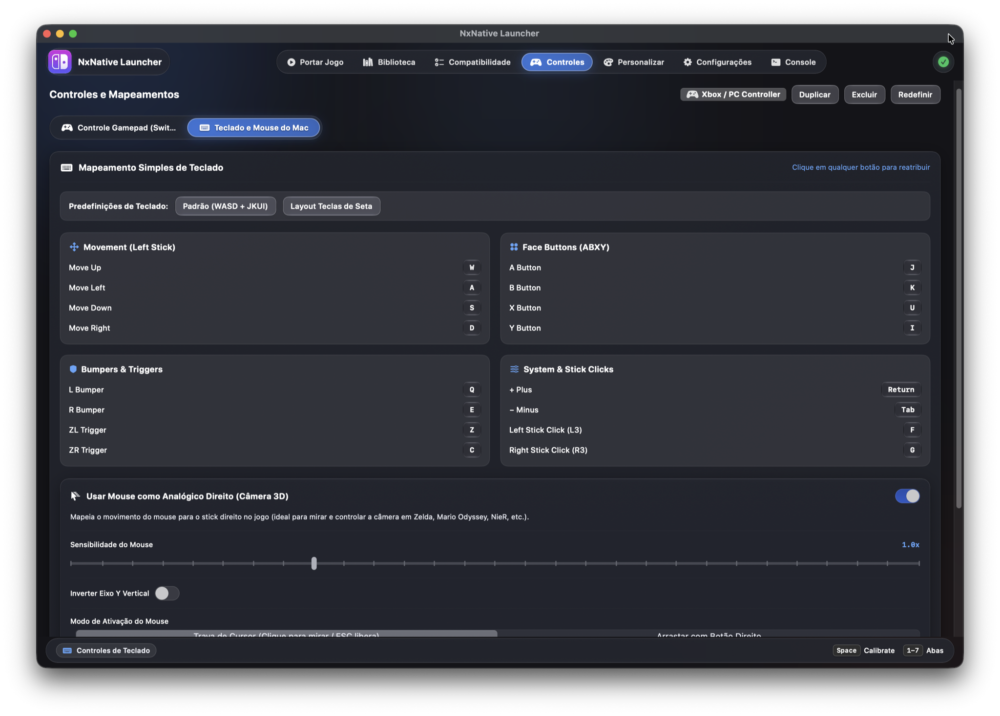

<div align="center">

<!-- Tab Navigation Header -->
<div align="center">
  <a href="README.md"><b>📖 Overview & Guide</b></a> &nbsp;&nbsp;|&nbsp;&nbsp;
  <a href="SUPPORTED_GAMES.md"><b>🎮 Supported Games & Timeline</b></a> &nbsp;&nbsp;|&nbsp;&nbsp;
  <a href="CONTRIBUTING.md"><b>🤝 Contributing</b></a>
</div>

<br>

<a href="https://github.com/rennan101/nxnative_Launcher">
  
</a>

# NxNative Launcher

### The Definitive Native Game Porting & Playback Suite for Apple Silicon

[](https://apple.com/macos)
[-orange.svg)](https://apple.com)
[](https://github.com/rennan101/nxnative_Launcher/releases)
[](https://github.com/rennan101/nxnative_Launcher/stargazers)
[](SUPPORTED_GAMES.md)
[](LICENSE)
[](https://github.com/seedds/nxnative)
[](https://github.com/rennan101/nxnative_Launcher/actions/workflows/sync-upstream.yml)

<p align="center">
  <b>Port, configure, and play your legally owned Nintendo Switch games natively on Apple Silicon Macs and iOS devices with true 60 FPS, Apple Metal 4 & MetalFX, 3D Mouse Look Camera Control, Universal Gamepad & Key Remapping, Cross-Save iCloud Sync, and zero terminal friction.</b>
</p>

<p align="center">
  <b>⚡ It is not an emulator</b>: The game's ARM64 code runs directly on the Apple Silicon CPU, with graphics rebuilt natively on Metal. No runtime translation overhead, no JIT stutter, and exceptional battery efficiency.
</p>

<p align="center">
  <a href="#-table-of-contents--índice-rápido"><b>🇺🇸 English Documentation</b></a> • 
  <a href="#-guia-rápido-em-português-pt-br"><b>🇧🇷 Guia em Português (PT-BR)</b></a> •
  <a href="SUPPORTED_GAMES.md"><b>🎮 Supported Games List (111 Titles)</b></a>
</p>

</div>

---

## 📑 Table of Contents / Índice Rápido

| Section | Highlights |
| :--- | :--- |
| [🎬 Live Showcase](#live-showcase) | Console library carousel demo & visual interface tour |
| [💡 Why Native Recompilation?](#why-native-recompilation-the-advantage) | Emulation vs. NxNative comparison, 0% CPU translation penalty |
| [✨ Key Innovations & Build Highlights](#key-innovations-current-build-highlights) | 3D Mouse Look, Keyboard remapper, Drag & Drop library, 14 locales, iCloud sync |
| [⚡ Quick Start Guide](#quick-start-guide) | 60-second player setup & source developer instructions |
| [🛠️ Environment & Prerequisites](#environment-prerequisites) | In-app automated installer & manual terminal commands |
| [🚀 3-Step Porting Tutorial](#3-step-porting-tutorial) | Drag & drop, target platform selection (.app / .ipa), launching |
| [🕹️ Configuration, Mods & Saves](#configuration-saves-atmosphere-mods) | LayeredFS mods, 60 FPS patches, and 1-click save backups |
| [🎮 Controls & 3D Camera Guide](#controls-3d-camera-guide) | FPS mouse look, gamepad presets, custom key mapping |
| [📚 Supported Games Catalog](#supported-games-catalog-111-titles) | 111 verified upstream games, RAM tiers, link to [SUPPORTED_GAMES.md](SUPPORTED_GAMES.md) |
| [🗺️ Roadmap & Community Lineage](#roadmap-community-lineage) | Completed milestones, seedds/nxnative core, clean-room policy |
| [🇧🇷 Guia Rápido em Português](#guia-rápido-em-português-pt-br) | Instalação simplificada, tutorial passo a passo e controles |

---

## 🎬 Live Showcase

> Experience a console-grade desktop application with fluid cover carousels, responsive neon accents, and instantaneous 60 FPS performance toggles in full Retina clarity:

<p align="center">
  
</p>

---

## 💡 Why Native Recompilation? The Advantage

Traditional Nintendo Switch emulators (such as Yuzu or Ryujinx) rely on **Just-In-Time (JIT) dynamic translation** and dynamic shader translation. On Apple Silicon, this introduces substantial CPU overhead, micro-stutters during shader compilation, and heavy thermal battery drain.

**NxNative Launcher** utilizes ahead-of-time (AOT) native static recompilation powered by [`seedds/nxnative`](https://github.com/seedds/nxnative). Game binaries are converted directly into native macOS/iOS Mach-O executables, with shaders rebuilt ahead-of-time directly for Apple Metal:

| Benchmark / Metric | Traditional Emulation | 🚀 NxNative Native Recompilation | Player & Developer Benefit |
| :--- | :---: | :---: | :--- |
| **CPU Overhead** | High (40% – 85% CPU load) | **Near Zero (10% – 25% CPU load)** | Cooler operation, zero CPU bottleneck, max battery life |
| **Shader Compilation** | Runtime JIT (Shader stutter) | **Ahead-of-Time Metal Prebuild** | Silky smooth 60 FPS with zero mid-game stuttering |
| **Graphics API** | Vulkan / MoltenVK wrapper | **Direct Native Metal 4 & MetalFX** | Full hardware upscaling, HDR, and Retina sharpness |
| **Controls & Camera** | Clunky simulated stick | **True 3D Mouse Look (FPS Mode)** | Play third/first-person games with native PC mouse precision |
| **Library Organization**| Static text lists | **Switch Dark Mode + Drag & Drop** | Modern console carousel with custom order via mouse drag |
| **Cross-Platform Saves**| Manual directory navigation | **Smart iCloud Sync & 1-Click Finder** | Seamless continuity between Mac and iPhone 15/16 Pro |
| **Porting Complexity** | Terminal scripts & flags | **3-Step Visual Wizard** | Zero command-line friction; auto-detects DLCs and updates |

---

## ✨ Key Innovations & Current Build Highlights

### 1. Console-Style Game Library with Mouse Drag & Drop
- **16:9 Hero Section & Authentic Box Art Shelf**: High-resolution panoramic art paired with authentic vertical box art (1 : 1.60 ratio).
- **Interactive Library Drag & Drop**: Reorganize your game shelf directly by dragging and dropping cards with your mouse; your personal custom ordering is saved automatically.
- **Two-Tier Category Shelves**:
  - **Mac (macOS Native)**: Standalone compiled `.app` bundles running directly on Apple Silicon Metal.
  - **iPhone / iPad (iOS Port)**: Sideloadable `.ipa` packages ready for direct deployment via `xcrun devicectl` or AirDrop.

<p align="center">
  
</p>

---

### 2. True 3D Mouse Look (FPS Camera Control)
- **First-Person & Third-Person Camera Freedom**: Control game cameras directly with smooth mouse movements.
- **Adjustable Sensitivity & Invert Y**: Granular sensitivity sliders for both X and Y axes, plus an inverted pitch toggle.
- **Instant Hotkey Toggle**: Seamlessly engage or disengage mouse capture with a single configurable shortcut (`F1` by default).

<p align="center">
  
</p>

---

### 3. Universal Controller & Keyboard Remapper (with Mouse 4 & 5 Capture)
- **Zero-Conflict Input Engine**: Redesigned keyboard and gamepad capture engine supporting letter keys, modifiers, and extra mouse buttons (**Mouse Button 4 / Back** and **Mouse Button 5 / Forward**).
- **Plug & Play Gamepads**: Built-in visual profiles for Nintendo Switch Pro Controller, PlayStation DualSense / DualShock 4, and Xbox Wireless Controllers.
- **Couch-Friendly Navigation**: Hold the controller Guide / Home button for 3 seconds to instantly return from a running game to the launcher.

<p align="center">
  
</p>

---

### 4. Smart iCloud Cross-Save & Single-Button Device Sync
- **Automatic Save Resolution**: Automatically indexes `~/Library/Application Support/nxnative/<TID>/save` with a one-click **"Saves"** button to reveal files in Finder.
- **Bidirectional Device Sync**: Instantly transfer save files and Atmosphere mods between your Mac and paired iPhones or iPads.

<p align="center">
  
</p>

---

### 5. Atmosphere LayeredFS Mods & Custom Covers
- **Custom Artwork Picker**: Customize box art with any local `.jpg`, `.png`, or `.webp` image, persisted automatically.
- **Integrated Mod Manager**: Drop mods directly into `<Game.app>/Contents/Resources/atmosphere/contents/<TitleID>/` for instant HD texture packs, 60 FPS patches, or community translations.

<p align="center">
  
</p>

---

### 6. Apple Liquid Glass UI, Joy-Con Icon & 14 Locales
- **Apple Liquid Glass Translucency**: Native macOS Sonoma and Sequoia glassmorphism with high-contrast neon accents.
- **Official Joy-Con Status Bar Icon**: Customize the macOS menu bar icon between the classic Joy-Con silhouette and the launcher icon.
- **14 International Locales**: Sorted alphabetically in Settings for effortless selection:
  - 🇺🇸 English • 🇧🇷 Português (Brasil) • 🇵🇹 Português (Portugal) • 🇯🇵 日本語 • 🇪🇸 Español • 🇫🇷 Français • 🇩🇪 Deutsch • 🇮🇹 Italiano • 🇰🇷 한국어 • 🇵🇱 Polski • 🇷🇺 Русский • 🇸🇪 Svenska • 🇨🇳 简体中文 • 🇭🇰 繁體中文.

<p align="center">
  
</p>

---

## ⚡ Quick Start Guide

### 🎮 For Gamers (Play in 60 Seconds)
1. **Download the Release**: Grab the latest `NxNative_Launcher.dmg` from the [Releases](https://github.com/rennan101/nxnative_Launcher/releases) page.
2. **Mount and Install**: Open the `.dmg` and drag `NxNative_Launcher.app` into your `Applications` folder.
3. **Launch & Auto-Install**: On first launch, if toolchains are missing, click **"Install Missing Dependencies"** in Settings. The app handles Homebrew, Python, and required packages automatically.
4. **Port Your First Game**: Go to the **Port** tab, drag and drop your game dump folder, click **"Start Porting"**, and play!

### 🛠️ For Developers (Build from Source)
```bash
# 1. Clone repository with submodules
git clone --recurse-submodules https://github.com/rennan101/nxnative_Launcher.git
cd nxnative_Launcher

# 2. Build the Swift GUI application
./scripts/build_gui.sh

# 3. Launch the compiled application
open NxNative_Launcher.app
```

---

## 🛠️ Environment & Prerequisites

### System Requirements
* **Operating System**: macOS 13.0 (Ventura), macOS 14.0 (Sonoma), or macOS 15.0+ (Sequoia).
* **Architecture**: Apple Silicon Mac (M1, M2, M3, M4 or higher) or iOS 18+ (A17 Pro, A18, A18 Pro).
* **Storage**: 15–20 GB of free space recommended for compilation toolchains, caches, and RomFS assets.

### Manual Dependency Installation (Optional)
If you prefer setting up dependencies manually via Terminal instead of the in-app installer:
```bash
# 1. Install Xcode Command Line Tools
xcode-select --install

# 2. Install Homebrew packages
brew install python@3.13 cmake ninja pkg-config

# 3. Install Python dependencies for asset extraction & shader translation
python3 -m pip install --break-system-packages \
  pycryptodome zstandard lz4 libhac
```

---

## 🚀 3-Step Porting Tutorial

<p align="center">
  
</p>

### Step 1: Drag & Drop Game Dumps
Drop any folder containing your dumped `.nsp`, `.nsz`, `.xci`, or `.zip` archives. The wizard automatically matches Base games with their corresponding Updates and DLC packs.

### Step 2: Configure Target & Enhancements
Choose your target output:
- **macOS Native Application (`.app`)**: Ready for instant double-click playback on your Mac.
- **iOS Sideloadable Package (`.ipa`)**: Ready for iPhone 15 Pro, iPhone 16 Pro, or iPad Pro.
- Select your desired performance targets (60 FPS uncap, MetalFX upscaling, Metal Performance HUD).

### Step 3: Library Launch & Device Sideloading
Monitor real-time progress from ExeFS extraction to Metal shader building. Once finished, launch directly from the **Library** or deploy to iOS via AirDrop / `xcrun devicectl`.

---

## 🕹️ Configuration, Saves & Atmosphere Mods

### Game Details Deck
Clicking any game in the Library opens the **Game Details Deck**:
* **60 FPS & MetalFX**: Toggle high frame rates and Metal upscaling dynamically.
* **Atmosphere LayeredFS Mods**: Add mods to `<Game.app>/Contents/Resources/atmosphere/contents/<TitleID>/`.
* **Save Management**: Reveal saves in Finder with a single click, or sync bi-directionally with iOS devices.

---

## 🎮 Controls & 3D Camera Guide

### Mouse & Keyboard (FPS Mode)
| Action | Default Shortcut |
| :--- | :--- |
| **Toggle 3D Mouse Look** | `F1` (Configurable) |
| **Camera Movement** | Mouse movement (X/Y Sensitivity adjustable) |
| **Movement (Left Stick)** | `W` / `A` / `S` / `D` |
| **Face Buttons (A / B / X / Y)** | `L` / `K` / `I` / `O` (or remapped to Mouse 4 / 5) |
| **Triggers (ZL / ZR)** | `Q` / `E` |
| **Bumpers (L / R)** | `U` / `P` |
| **Plus (+) / Minus (-)** | `Return` / `Tab` |

### Gamepad Mapping Reference
| Switch Action | Xbox Controller | PlayStation DualSense |
| :--- | :---: | :---: |
| **A / B / X / Y** | B / A / Y / X (Nintendo Layout) | Circle / Cross / Triangle / Square |
| **Left Stick / D-Pad** | Left Stick / D-Pad | Left Stick / D-Pad |
| **Camera (Right Stick)** | Right Stick | Right Stick |
| **ZL / ZR** | Left Trigger / Right Trigger | L2 / R2 |
| **Exit to Launcher** | Hold Xbox Guide (3s) | Hold PS Button (3s) |

---

## 📚 Supported Games Catalog (111 Titles)

NxNative Launcher tracks **111 verified playable game profiles** synchronized directly with [`seedds/nxnative`](https://github.com/seedds/nxnative).

<p align="center">
  
</p>

### 🌟 Flagship Highlights
* **The Legend of Zelda: Tears of the Kingdom** (`0100F2C0115B6000`): **⚡ 60 FPS** with 1.4.3
* **The Legend of Zelda: Breath of the Wild** (`01007EF00011E000`): **⚡ 60 FPS** with 1.9.0
* **Super Mario Odyssey** (`0100000000010000`): Native 60 FPS on Metal
* **Mario Kart 8 Deluxe** (`0100152000022000`): Native 60 FPS, full speed
* **ASTRAL CHAIN** (`01007300020FA000`): **⚡ 60 FPS target** with 1.0.1
* **Paper Mario: The Thousand-Year Door** (`0100ECD018EBE000`): **⚡ 60 FPS** with 1.0.1
* **Nier: Automata The End of YoRHa Edition** (`010015100B514000`): Full Metal speed

👉 **[View the Complete 111 Supported Games List, Memory Tiers & Changelog in SUPPORTED_GAMES.md ➔](SUPPORTED_GAMES.md)**

---

## 🗺️ Roadmap & Community Lineage

### ✅ Completed Milestones
* [x] **3-Step Guided Porting Wizard** with auto Base + Update + DLC grouping.
* [x] **True 3D Mouse Look (FPS Mode)** with sensitivity controls and invert Y.
* [x] **Interactive Keyboard & Gamepad Remapper** with Mouse 4 & 5 capture.
* [x] **Mouse Drag & Drop Library Organization** in Switch Dark Mode carousel.
* [x] **Smart iCloud Cross-Save Synchronization** and 1-click Finder reveal.
* [x] **Direct iOS `.ipa` Deployment** via AirDrop and `xcrun devicectl`.
* [x] **Atmosphere LayeredFS Mod Manager** and custom cover art integration.
* [x] **14 Locales Multi-Language** with alphabetical locale selection.
* [x] **Joy-Con Status Bar Icon** and Apple Liquid Glass design.
* [x] **Automated Upstream Synchronization** with `seedds/nxnative` (111 verified games).

### ⏳ In Active Development
* [ ] Dynamic resolution scaling and MetalFX Frame Generation.
* [ ] Gamepad rumble / haptic feedback over Bluetooth on macOS Sequoia.
* [ ] Wireless Local Wireless / LAN multiplayer emulation bridge.

---

## ⚖️ Clean-Room & Legal Policy

> [!IMPORTANT]
> - **No Proprietary Keys**: This repository and application **DO NOT** contain, host, link to, or distribute any Nintendo cryptographic keys (`prod.keys`, `title.keys`), key seeds, or certificates. Users must dump their own keys from their personally owned Nintendo Switch hardware.
> - **No Games or ROMs**: **NO** game binaries, NSPs, XCIs, DLC files, game updates, or copyrighted assets are provided, distributed, or mirrored. Users must provide their own legally obtained game dumps.
> - **Independent Interoperability**: NxNative Launcher is purely an open-source graphical orchestration interface and utility tool built for Apple Silicon execution interoperability.
> - **Core Engine Lineage**: The recompilation engine is based on the open-source clean-room work of [`seedds/nxnative`](https://github.com/seedds/nxnative).

---

## 🇧🇷 Guia Rápido em Português (PT-BR)

### O que é o NxNative Launcher?
O **NxNative Launcher** é uma aplicação desktop nativa desenvolvida em Swift para Apple Silicon (Mac M1/M2/M3/M4 e iPhone 15/16 Pro). **Ele não é um emulador**: o código do jogo roda diretamente no processador da Apple sem tradução dinâmica (JIT), e os gráficos são reconstruídos diretamente em **Apple Metal 4**.

### Principais Vantagens para o Usuário
1. **Desempenho Real de 60 FPS**: Sem travamentos de compilação de shaders durante a jogatina.
2. **Eficiência de Bateria**: Jogue no MacBook sem aquecimento excessivo e com horas a mais de bateria.
3. **Câmera 3D no Mouse**: Jogue no mouse e teclado com controle livre de câmera estilo FPS.
4. **Remapeamento com Botões Laterais**: Configure teclas facilmente, incluindo os botões laterais do mouse (Mouse 4 e 5).
5. **Organização da Biblioteca por Arrastar e Soltar**: Reordene seus jogos puxando os cards com o mouse.
6. **Saves no iCloud**: Comece jogando no Mac e continue no iPhone com sincronização em 1 clique.
7. **14 Idiomas Suportados**: Totalmente traduzido para Português do Brasil e Português de Portugal.

### Como Começar em 3 Passos
1. **Baixar o App**: Baixe o arquivo `NxNative_Launcher.dmg` na aba de [Releases](https://github.com/rennan101/nxnative_Launcher/releases) e arraste para sua pasta `Aplicativos`.
2. **Configuração Automática**: Abra o launcher. Na aba **Settings**, caso falte alguma ferramenta, clique em **"Instalar Dependências Faltantes"** (o app instala Homebrew, Python e bibliotecas automaticamente).
3. **Portar e Jogar**: Vá para a aba **Port**, arraste a pasta com seus dumps do jogo (`.nsp` ou `.xci`), clique em **"Iniciar Portabilidade"** e pronto! O jogo aparecerá na sua biblioteca pronto para jogar.

Consulte a lista completa de [111 Jogos Suportados e Histórico de Features em SUPPORTED_GAMES.md](SUPPORTED_GAMES.md).

---

<div align="center">
  <p><b>NxNative Launcher is an independent open-source project and is not affiliated with, endorsed by, or connected to Nintendo Co., Ltd.</b></p>
  <a href="SUPPORTED_GAMES.md"><b>🎮 Supported Games (111 Titles)</b></a> &nbsp;&nbsp;•&nbsp;&nbsp;
  <a href="CONTRIBUTING.md"><b>🤝 Contributing</b></a> &nbsp;&nbsp;•&nbsp;&nbsp;
  <a href="https://github.com/rennan101/nxnative_Launcher/issues"><b>🐞 Report Bug</b></a>
</div>
