<div align="center">

<a href="https://github.com/rennan101/nxnative_Launcher">
  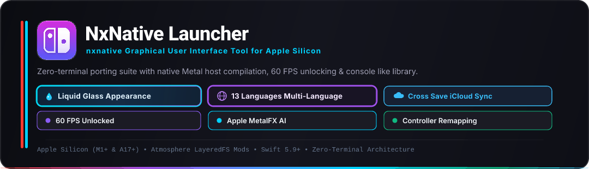
</a>

# NxNative Launcher

### Open-Source nxnative Graphical User Interface Tool for Apple Silicon

[](https://apple.com/macos)
[-orange.svg)](https://apple.com)
[](https://swift.org)
[](https://github.com/rennan101/nxnative_Launcher/releases)
[](#)
[](#)
[](LICENSE)
[](https://github.com/seedds/nxnative)
[](https://github.com/rennan101/nxnative_Launcher/issues)
[](https://github.com/rennan101/nxnative_Launcher/actions/workflows/sync-upstream.yml)

<p align="center">
  <b>Port, configure, and play your owned Switch games natively on Apple Silicon Macs and iOS devices with 60 FPS, Apple MetalFX, Controller Remapping, Cross Save Sync, and zero command-line friction.</b>
</p>
<p align="center">
<b>It is not an emulator: the game's own code runs directly on the Apple chip, with Switch graphics rebuilt on Metal. Nothing from any game is in this repository, and the project is not affiliated with Nintendo or any game publisher.<b>
</p>

<p align="center">
  <a href="#-english-documentation"><b>🇺🇸 English Documentation</b></a> • 
  <a href="#-guia-em-português-pt-br"><b>🇧🇷 Guia em Português (PT-BR)</b></a>
</p>

</div>

---

## 📑 Table of Contents / Índice Rápido

* [🎬 Live Demo (The Hook)](#-live-demo)
* [⚖️ Clean-Room & Legal Policy](#-zero-copyrighted-assets-distributed-strict-clean-room-policy)
* [💡 Why NxNative Launcher?](#-why-nxnative-launcher)
* [✨ Key Features](#-key-features)
  * [1. Console Game Library (Switch Dark Mode)](#1-console-style-game-library)
  * [2. Custom Covers & Atmosphere Mods](#2-custom-covers-atmosphere-mods--layeredfs)
  * [3. 3-Step Guided Porting Wizard](#3-3-step-guided-porting-wizard)
  * [4. Controller Remapping & Universal Gamepad](#4-controller-remapping--universal-gamepad-navigation)
  * [5. Compatibility Matrix & RAM Filters](#5-compatibility-matrix-ram-filters--live-github-sync)
  * [6. Personalization & 8 Neon Themes](#6-personalization--8-neon-highlight-themes)
  * [7. Engine Compatibility Patches & Upstream Sync](#7-engine-compatibility-patches--upstream-synchronization)
* [⚡ Quick Start Guide](#-quick-start-guide)
  * [For Gamers (Play in 60 Seconds)](#-for-gamers-play-in-60-seconds)
  * [For Developers (Build from Source)](#-for-developers-build-from-source)
* [🛠️ Environment Setup & Prerequisites](#-environment-setup--prerequisites)
* [🚀 Step-by-Step Porting Tutorial](#-step-by-step-porting-tutorial)
* [🕹️ Library Configuration & Launching](#-how-to-configure-and-play-your-game)
* [🎮 Gamepad Navigation Reference](#-gamepad-navigation-reference)
* [🗺️ Interactive Roadmap](#-interactive-roadmap)
* [❓ Frequently Asked Questions (FAQ)](#-frequently-asked-questions-faq)
* [🏛️ Upstream Architecture & Credits](#-upstream-architecture--community-lineage)
* [🇧🇷 Guia em Português (PT-BR)](#-guia-em-português-pt-br)
  * [Instalação de Dependências](#1-configuração-do-ambiente-e-dependências)
  * [Passo a Passo de Portabilidade](#2-passo-a-passo-como-portar-jogos)
  * [Configuração na Biblioteca, Saves e Mods](#3-configuração-na-biblioteca-saves-e-mods)
  * [Remapeamento de Controles e Como Jogar](#4-remapeamento-de-controles-e-como-jogar)
  * [Suporte e Relato de Erros](#5-suporte-e-relato-de-erros)

---

## 🎬 Live Demo

> Experience a console-grade desktop application with fluid cover carousels, responsive neon accents, and instantaneous 60 FPS performance toggles in full Retina clarity:

<p align="center">
  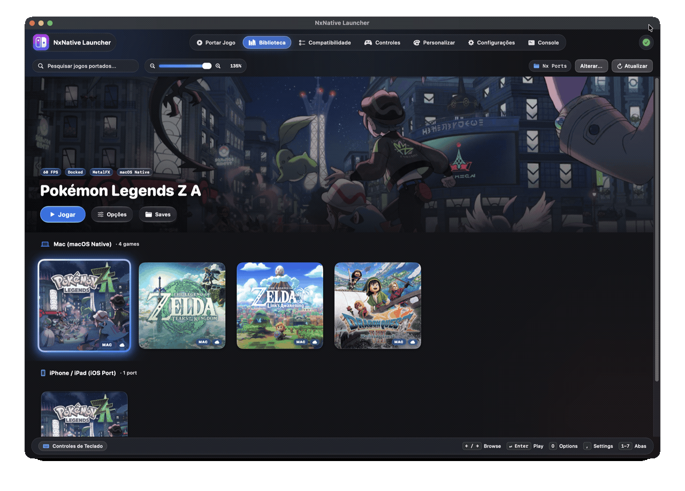
</p>

---

## ⚖️ ZERO COPYRIGHTED ASSETS DISTRIBUTED (Strict Clean-Room Policy)

> [!IMPORTANT]
> - **No Proprietary Keys**: This repository and application **DO NOT** contain, host, link to, or distribute any Nintendo cryptographic keys (`prod.keys`, `title.keys`), key seeds, or certificates. Users must dump their own keys from their personally owned Nintendo Switch hardware.
> - **No Games or ROMs**: **NO** game binaries, NSPs, XCIs, DLC files, game updates, or copyrighted assets are provided, distributed, or mirrored. Users must provide their own legally obtained game dumps.
> - **Independent Interoperability**: NxNative Launcher is purely an open-source graphical orchestration interface and utility tool built for Apple Silicon execution interoperability.

---

## 💡 Why NxNative Launcher?

Running Nintendo Switch games on Apple Silicon with upstream tools historically required manual terminal scripting, manual LibHac extractions, custom SPIRV-Cross flags, and hand-edited environment variables. **NxNative Launcher** brings the entire ecosystem into a seamless, console-like desktop interface.

| Feature | Raw Command-Line Porting | 🎮 NxNative Launcher (v1.7.0) |
| :--- | :---: | :---: |
| **User Interface** | Terminal Commands only | **Switch Dark Mode Console Library** |
| **Controller Remapping**| Fixed hardcoded layouts | **Custom Profiles (Switch Pro, Xbox, PS5, Keyboard)** |
| **Save Synchronization**| Hidden Application Support paths | **Cross-Device Save Sync & 1-Click Finder Reveal** |
| **Game Bundling** | Manual multi-step extraction | **Automatic Base + Update + DLC Grouping** |
| **Performance Tuning** | Manual `env.txt` edits | **1-Click 60 FPS, MetalFX & Metal HUD** |
| **Game Mods (LayeredFS)**| Manual directory navigation | **Integrated Atmosphere Mod Manager** |
| **Target Deployment** | Mac only via terminal | **Dual Target: Mac Native (.app) & iOS (.ipa)** |
| **Exit Game from Couch**| Force quit or terminal kill | **Hold Guide/Home for 3s to return to Launcher** |

---

## ✨ Key Features

### 1. Console-Style Game Library
- **16:9 Hero Section & Box Art Shelf**: High-resolution panoramic art paired with authentic vertical box art (1 : 1.60 ratio).
- **Two-Tier Category Shelves**:
  - **Mac (macOS Native)**: Standalone compiled `.app` bundles running directly on Apple Silicon Metal.
  - **iPhone / iPad (iOS Port)**: Sideloadable `.ipa` packages ready for direct deployment via `xcrun devicectl` or AirDrop.
- **Cross Save & Backup**: Instantly resolves `~/Library/Application Support/nxnative/<TID>/save` with a one-click **"Saves"** button to reveal in Finder and synchronize with iOS paired devices.
- **Installed DLC & Update Detection**: Scans `<Game.app>/Contents/Resources/aoc` and displays installed expansions and bundle storage size.

<p align="center">
  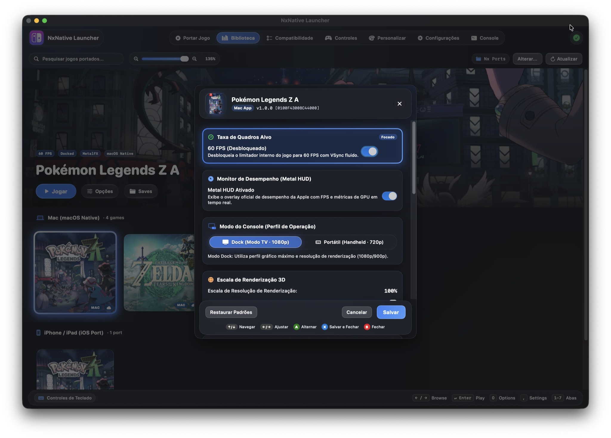
</p>

---

### 2. Custom Covers, Atmosphere Mods & LayeredFS
- **Custom Cover Art Picker**: Customize game artwork with any local `.jpg`, `.png`, or `.webp` file. Persisted automatically to user cache and embedded into the application bundle.
- **Atmosphere LayeredFS Mods**: Drop game mods directly into `<Game.app>/Contents/Resources/atmosphere/contents/<TitleID>/` for instant HD texture packs, translations, or physics tweaks.
- **Save File Quick Backups**: One-click direct access to save states for easy backup and synchronization.

<p align="center">
  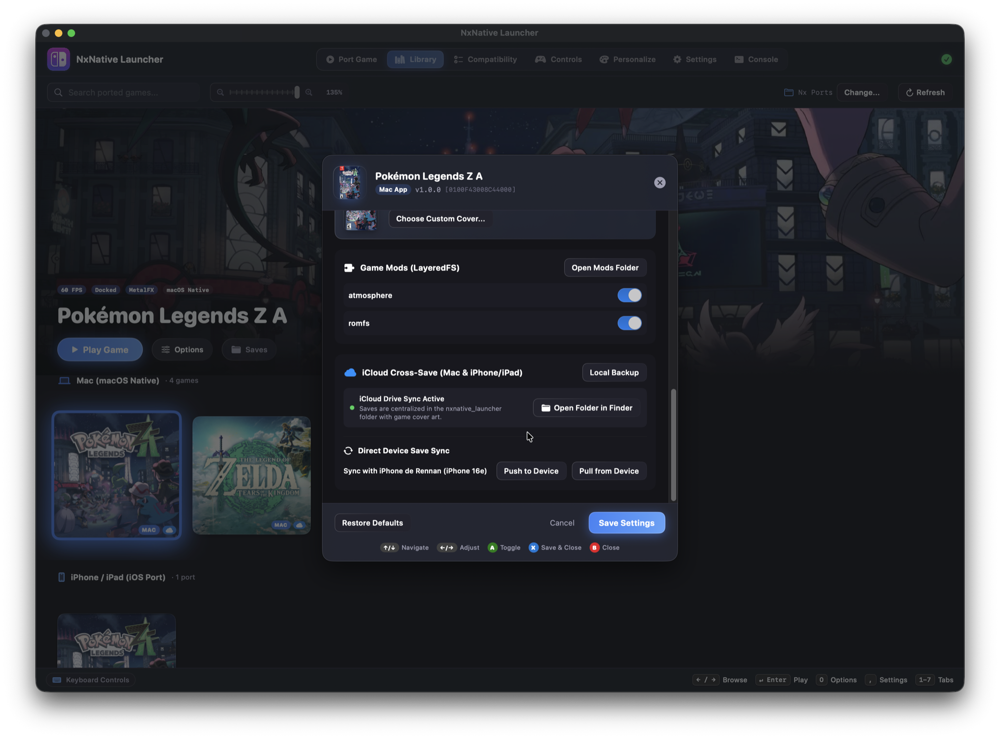
</p>

---

### 3. 3-Step Guided Porting Wizard
- **Automated Game Discovery**: Drag and drop any folder containing `.nsp`, `.nsz`, `.xci`, or `.zip` archives. The wizard automatically groups base games with their corresponding updates and DLC packages.
- **Target Platform Selection**: Output double-clickable macOS applications (`.app`) or iOS packages (`.ipa`) tailored for iPhone 15 Pro and Apple Silicon iPads.
- **Live Pipeline Execution**: Real-time progress monitoring from ExeFS extraction to SPIR-V compilation and Mach-O host linking (`dmhost`).

<p align="center">
  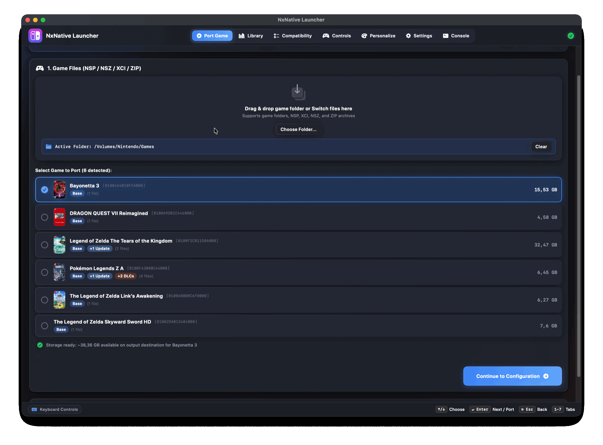
</p>

---

### 4. Controller Remapping & Universal Gamepad Navigation
- **Custom Button Remapping**: Rebind any controller button, trigger, or stick click with dedicated profile management (Gamepad Controller and Mac Keyboard & Mouse profiles).
- **Plug & Play Support**: Native compatibility with **Nintendo Switch** (Joy-Cons & Pro Controller), **Xbox** (Series S/X, One, Bluetooth), **PlayStation** (DualShock 4 & DualSense PS5), **8BitDo**, and MFi gamepads via Apple's native `GameController` framework.
- **Adaptive Glyphs & Haptic Audio**: On-screen prompts automatically match your connected controller (A/B/X/Y or ✕/○/□/△) with tactile mechanical audio feedback (`NSSound`).
- **3-Second Couch Exit Shortcut**: Hold the **Xbox Guide / PS / Home** button for **3 seconds** during gameplay to close the game and immediately reactivate the Launcher.

---

### 5. Compatibility Matrix (RAM Filters & Live GitHub Sync)
- **Live Upstream Sync**: Browse tested playable games synced directly with upstream compatibility reports.
- **RAM Requirement Filters**: Filter verified games instantly by Unified Memory: **All**, **4GB**, **6GB**, **8GB**, and **16GB**.
- **Hardware Requirement Badges**: Displays minimum Mac Unified Memory, iOS RAM, and required SSD storage space.

<!-- gallery: written by dm/tools/docs_gallery.py from docs/images/gallery.tsv; change the table, then run it -->
<table>
<tr>
<td align="center" valign="top" width="33%"><br><sub><b>Mario Kart 8 Deluxe</b><br>~11.9 GB · no Mii heads</sub></td>
<td align="center" valign="top" width="33%"><br><sub><b>Mario vs. Donkey Kong</b><br>~1.6 GB</sub></td>
<td align="center" valign="top" width="33%"><br><sub><b>Paper Mario: The Thousand-Year Door</b><br>~5 GB · 60 fps with 1.0.1</sub></td>
</tr>
<tr>
<td align="center" valign="top" width="33%"><br><sub><b>Super Mario 3D World + Bowser's Fury</b><br>~3 GB</sub></td>
<td align="center" valign="top" width="33%"><br><sub><b>Super Mario Bros. Wonder</b><br>~4 GB</sub></td>
<td align="center" valign="top" width="33%"><br><sub><b>Super Mario Galaxy</b><br>~3 GB</sub></td>
</tr>
<tr>
<td align="center" valign="top" width="33%"><br><sub><b>Super Mario Galaxy 2</b><br>~3 GB</sub></td>
<td align="center" valign="top" width="33%"><br><sub><b>Super Mario Odyssey</b><br>~6 GB</sub></td>
<td align="center" valign="top" width="33%"><br><sub><b>The Legend of Zelda: Breath of the Wild</b><br>~16 GB · 60 fps with 1.9.0</sub></td>
</tr>
<tr>
<td align="center" valign="top" width="33%"><br><sub><b>The Legend of Zelda: Link's Awakening</b><br>~6 GB</sub></td>
<td align="center" valign="top" width="33%"><br><sub><b>The Legend of Zelda: Tears of the Kingdom</b><br>~17 GB · 60 fps with 1.4.3</sub></td>
<td align="center" valign="top" width="33%"><br><sub><b>13 Sentinels: Aegis Rim</b><br>~5 GB</sub></td>
</tr>
<tr>
<td align="center" valign="top" width="33%"><br><sub><b>Absolum</b><br>~2 GB</sub></td>
<td align="center" valign="top" width="33%"><br><sub><b>Ace Attorney Investigations Collection</b><br>~7 GB</sub></td>
<td align="center" valign="top" width="33%"><br><sub><b>Advance Wars 1+2: Re-Boot Camp</b><br>~7.1 GB</sub></td>
</tr>
<tr>
<td align="center" valign="top" width="33%"><br><sub><b>AI: THE SOMNIUM FILES</b><br>~8.3 GB</sub></td>
<td align="center" valign="top" width="33%"><br><sub><b>AI: THE SOMNIUM FILES - nirvanA Initiative</b><br>~11.6 GB</sub></td>
<td align="center" valign="top" width="33%"><br><sub><b>Animal Crossing: New Horizons</b><br>~10.5 GB</sub></td>
</tr>
<tr>
<td align="center" valign="top" width="33%"><br><sub><b>ANIMAL WELL</b><br>~54 MB</sub></td>
<td align="center" valign="top" width="33%"><br><sub><b><a href="dm/games/01007300020FA000/README.md">ASTRAL CHAIN</a></b><br>~9.7 GB · 60 fps target with 1.0.1</sub></td>
<td align="center" valign="top" width="33%"><br><sub><b>Balatro</b><br>~82 MB · played by touch</sub></td>
</tr>
<tr>
<td align="center" valign="top" width="33%"><br><sub><b>BALL x PIT</b><br>~1.1 GB</sub></td>
<td align="center" valign="top" width="33%"><br><sub><b>Bayonetta</b><br>~8.8 GB</sub></td>
<td align="center" valign="top" width="33%"><br><sub><b>Bayonetta 2</b><br>~12.5 GB</sub></td>
</tr>
<tr>
<td align="center" valign="top" width="33%"><br><sub><b>Bayonetta 3</b><br>~14.2 GB</sub></td>
<td align="center" valign="top" width="33%"><br><sub><b>Big Brain Academy: Brain vs. Brain</b><br>~0.8 GB</sub></td>
<td align="center" valign="top" width="33%"><br><sub><b>Brain Memory Training Academy</b><br>~0.1 GB</sub></td>
</tr>
<tr>
<td align="center" valign="top" width="33%"><br><sub><b>Captain Toad: Treasure Tracker</b><br>~2 GB</sub></td>
<td align="center" valign="top" width="33%"><br><sub><b>Catherine: Full Body</b><br>~14 GB</sub></td>
<td align="center" valign="top" width="33%"><br><sub><b>Celeste</b><br>~0.9 GB</sub></td>
</tr>
<tr>
<td align="center" valign="top" width="33%"><br><sub><b>Cuphead</b><br>~5 GB</sub></td>
<td align="center" valign="top" width="33%"><br><sub><b>DARK SOULS: REMASTERED</b><br>~4 GB · 60 fps with 1.0.3</sub></td>
<td align="center" valign="top" width="33%"><br><sub><b>Digimon Story Cyber Sleuth: Complete Edition</b><br>~5 GB</sub></td>
</tr>
<tr>
<td align="center" valign="top" width="33%"><br><sub><b>Donkey Kong Country: Tropical Freeze</b><br>~7.3 GB</sub></td>
<td align="center" valign="top" width="33%"><br><sub><b>DRAGON QUEST VII Reimagined</b><br>~5.9 GB</sub></td>
<td align="center" valign="top" width="33%"><br><sub><b>DRAGON QUEST XI S: Echoes of an Elusive Age – Definitive Edition</b><br>~15 GB · 60 fps with 1.0.4</sub></td>
</tr>
<tr>
<td align="center" valign="top" width="33%"><br><sub><b>FINAL FANTASY RESONANCE</b><br>~10 GB · 60 fps with 1.0.1</sub></td>
<td align="center" valign="top" width="33%"><br><sub><b>FINAL FANTASY TACTICS - The Ivalice Chronicles</b><br>~11 GB</sub></td>
<td align="center" valign="top" width="33%"><br><sub><b>Fire Emblem Engage</b><br>~15 GB · 60 fps with 2.0.0</sub></td>
</tr>
<tr>
<td align="center" valign="top" width="33%"><br><sub><b>Fire Emblem: Three Houses</b><br>~13 GB · 60 fps with 1.2.0</sub></td>
<td align="center" valign="top" width="33%"><br><sub><b>Ghost Trick: Phantom Detective</b><br>~3 GB</sub></td>
<td align="center" valign="top" width="33%"><br><sub><b>The Great Ace Attorney Chronicles</b><br>~4 GB</sub></td>
</tr>
<tr>
<td align="center" valign="top" width="33%"><br><sub><b>Hades</b><br>~4 GB</sub></td>
<td align="center" valign="top" width="33%"><br><sub><b>Hades II</b><br>~4 GB</sub></td>
<td align="center" valign="top" width="33%"><br><sub><b>Hollow Knight: Silksong</b><br>~6.4 GB</sub></td>
</tr>
<tr>
<td align="center" valign="top" width="33%"><br><sub><b>Hyrule Warriors: Age of Calamity</b><br>~15 GB · 60 fps with 1.3.0</sub></td>
<td align="center" valign="top" width="33%"><br><sub><b>Kirby and the Forgotten Land</b><br>~6.4 GB</sub></td>
<td align="center" valign="top" width="33%"><br><sub><b>Luigi's Mansion 3</b><br>~7.5 GB · 60 fps with 1.4.0</sub></td>
</tr>
<tr>
<td align="center" valign="top" width="33%"><br><sub><b>Metroid Dread</b><br>~5 GB</sub></td>
<td align="center" valign="top" width="33%"><br><sub><b>Monster Hunter Rise</b><br>~22 GB · 60 fps with 16.0.2</sub></td>
<td align="center" valign="top" width="33%"><br><sub><b>Monster Train 2</b><br>~1.6 GB · 60 fps with 1.1.1</sub></td>
</tr>
<tr>
<td align="center" valign="top" width="33%"><br><sub><b>OCTOPATH TRAVELER</b><br>~3.6 GB</sub></td>
<td align="center" valign="top" width="33%"><br><sub><b>Octopath Traveler 0</b><br>~4 GB · 60 fps with 1.0.5</sub></td>
<td align="center" valign="top" width="33%"><br><sub><b>Octopath Traveler II</b><br>~5.9 GB · 60 fps with 1.1.1</sub></td>
</tr>
<tr>
<td align="center" valign="top" width="33%"><br><sub><b>Patrick's Parabox</b><br>~0.2 GB</sub></td>
<td align="center" valign="top" width="33%"><br><sub><b>Persona 5 Royal</b><br>~14.9 GB</sub></td>
<td align="center" valign="top" width="33%"><br><sub><b>Pikmin 4</b><br>~10.8 GB</sub></td>
</tr>
<tr>
<td align="center" valign="top" width="33%"><br><sub><b>Pokémon Brilliant Diamond</b><br>~4.6 GB · 60 fps with 1.3.0</sub></td>
<td align="center" valign="top" width="33%"><br><sub><b>Pokémon Legends: Z-A</b><br>~6 GB</sub></td>
<td align="center" valign="top" width="33%"><br><sub><b>Pokémon Scarlet</b><br>~7.0 GB</sub></td>
</tr>
<tr>
<td align="center" valign="top" width="33%"><br><sub><b>Pokémon Sword</b><br>~12.4 GB</sub></td>
<td align="center" valign="top" width="33%"><br><sub><b>Pokémon Shield</b><br>~12.4 GB</sub></td>
<td align="center" valign="top" width="33%"><br><sub><b>Portal</b><br>~2.6 GB</sub></td>
</tr>
<tr>
<td align="center" valign="top" width="33%"><br><sub><b>Raging Loop</b><br>~0.9 GB</sub></td>
<td align="center" valign="top" width="33%"><br><sub><b>Rhythm Heaven Groove</b><br>~3 GB</sub></td>
<td align="center" valign="top" width="33%"><br><sub><b>ROMANCE OF THE THREE KINGDOMS 8 REMAKE</b><br>~16.8 GB · controller only</sub></td>
</tr>
<tr>
<td align="center" valign="top" width="33%"><br><sub><b>Sea of Stars</b><br>~5.1 GB</sub></td>
<td align="center" valign="top" width="33%"><br><sub><b>SHIN MEGAMI TENSEI V: Vengeance</b><br>~14.6 GB · 60 fps with 1.0.3</sub></td>
<td align="center" valign="top" width="33%"><br><sub><b>Stardew Valley</b><br>~0.6 GB</sub></td>
</tr>
<tr>
<td align="center" valign="top" width="33%"><br><sub><b>STEINS;GATE RE:BOOT</b><br>~6 GB</sub></td>
<td align="center" valign="top" width="33%"><br><sub><b>Super Smash Bros. Ultimate</b><br>~17.5 GB · offline</sub></td>
<td align="center" valign="top" width="33%"><br><sub><b>Taiko Risshiden V DX</b><br>~3.3 GB · Japanese · played by touch</sub></td>
</tr>
<tr>
<td align="center" valign="top" width="33%"><br><sub><b>Unicorn Overlord</b><br>~4 GB</sub></td>
<td align="center" valign="top" width="33%"><br><sub><b><a href="dm/games/01006000040C2000/README.md">Yoshi's Crafted World</a></b><br>~6.1 GB</sub></td>
<td align="center" valign="top" width="33%"><br><sub><b>NieR:Automata The End of YoRHa Edition</b><br>~10.9 GB · 60 fps with 1.0.3</sub></td>
</tr>
<tr>
<td align="center" valign="top" width="33%"><br><sub><b>The Legend of Zelda: Echoes of Wisdom</b><br>~7.8 GB</sub></td>
<td align="center" valign="top" width="33%"><br><sub><b>Donkey Kong Country Returns HD</b><br>~11.6 GB</sub></td>
<td align="center" valign="top" width="33%"><br><sub><b>Mario + Rabbids Sparks of Hope</b><br>~9.8 GB</sub></td>
</tr>
<tr>
<td align="center" valign="top" width="33%"><br><sub><b>Xenoblade Chronicles 2</b><br>~17.1 GB</sub></td>
<td align="center" valign="top" width="33%">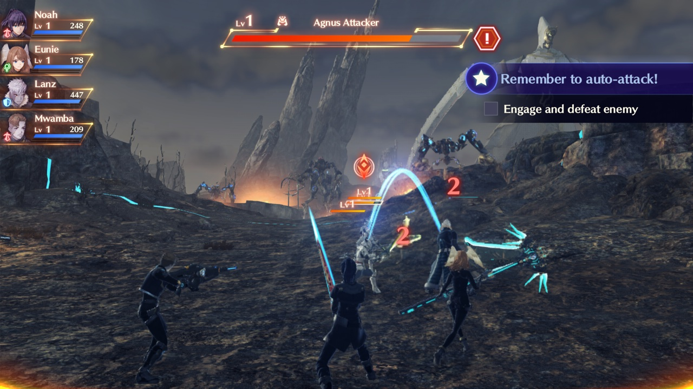<br><sub><b>Xenoblade Chronicles 3</b><br>~19.2 GB</sub></td>
<td align="center" valign="top" width="33%">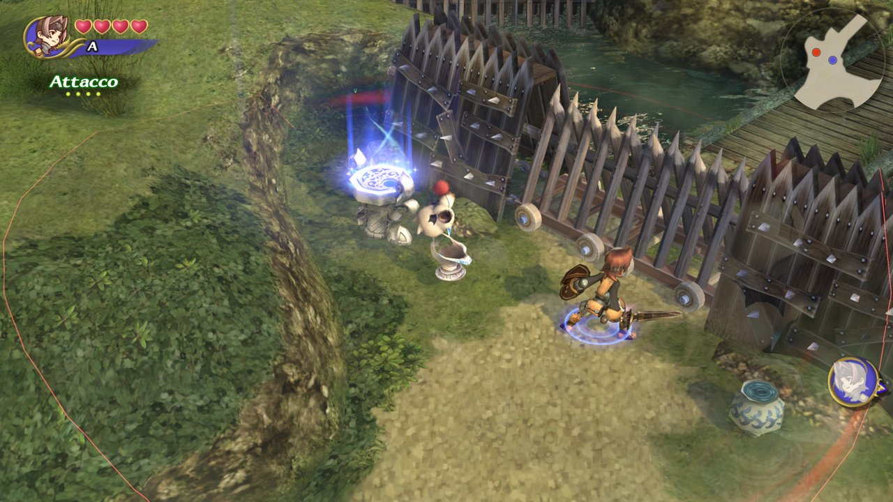<br><sub><b>FINAL FANTASY CRYSTAL CHRONICLES Remastered Edition</b></sub></td>
</tr>
<tr>
<td align="center" valign="top" width="33%"><br><sub><b><a href="dm/games/010032E00E6E2000/README.md">Return of the Obra Dinn</a></b><br>~0.9 GB</sub></td>
<td align="center" valign="top" width="33%"><br><sub><b><a href="dm/games/010040801A4C8000/README.md">Blasphemous 2</a></b><br>~1.5 GB</sub></td>
<td align="center" valign="top" width="33%">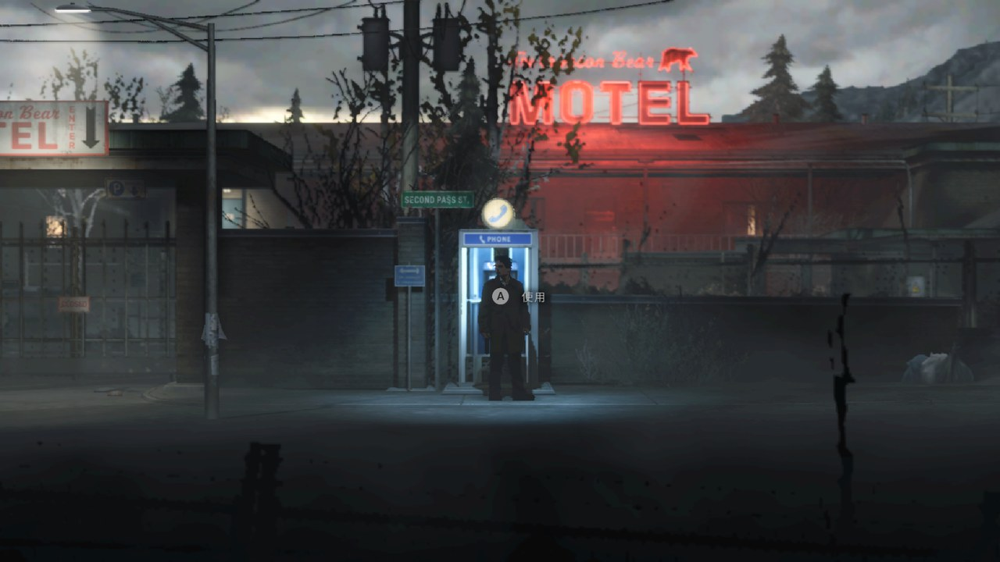<br><sub><b><a href="dm/games/0100D5B026844000/README.md">Silver Pines</a></b></sub></td>
</tr>
<tr>
<td align="center" valign="top" width="33%"><br><sub><b><a href="dm/games/0100698009C6E000/README.md">Blasphemous</a></b><br>~0.9 GB</sub></td>
<td align="center" valign="top" width="33%"><br><sub><b><a href="dm/games/0100BC300CB48000/README.md">FINAL FANTASY X/X-2 HD Remaster</a></b><br>~26.5 GB</sub></td>
<td align="center" valign="top" width="33%"><br><sub><b><a href="dm/games/010067300059A000/README.md">Mario + Rabbids Kingdom Battle</a></b><br>~5 GB</sub></td>
</tr>
<tr>
<td align="center" valign="top" width="33%"><br><sub><b><a href="dm/games/010062B01525C000/README.md">Persona 4 Golden</a></b></sub></td>
<td align="center" valign="top" width="33%"><br><sub><b><a href="dm/games/0100FF500E34A000/README.md">Xenoblade Chronicles: Definitive Edition</a></b><br>~13.2 GB</sub></td>
<td align="center" valign="top" width="33%"><br><sub><b><a href="dm/games/01001F5010DFA000/README.md">Pokémon Legends: Arceus</a></b><br>~4.2 GB</sub></td>
</tr>
<tr>
<td align="center" valign="top" width="33%"><br><sub><b><a href="dm/games/0100965017338000/README.md">Super Mario Party Jamboree</a></b></sub></td>
<td align="center" valign="top" width="33%">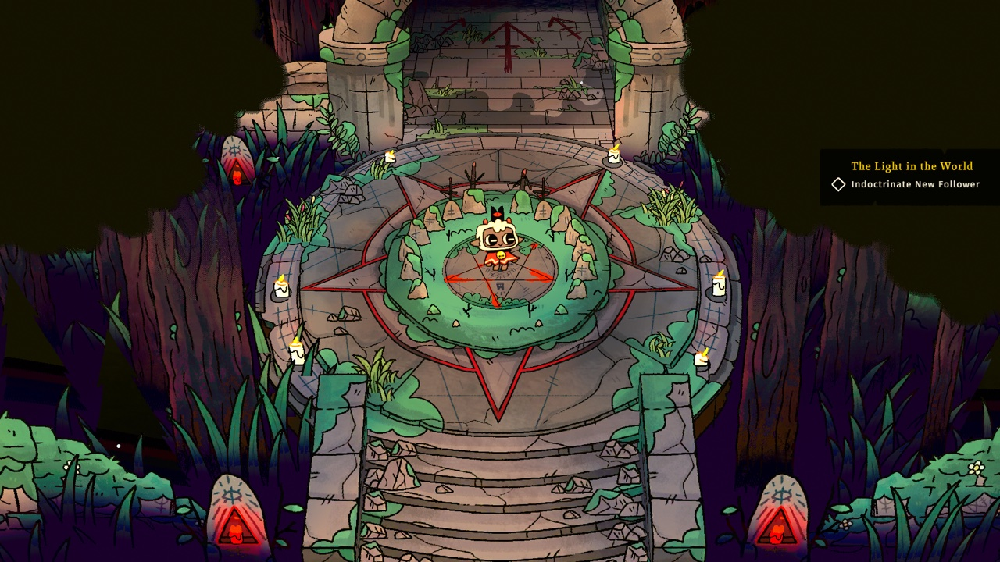<br><sub><b><a href="dm/games/01002E7016C46000/README.md">Cult of the Lamb</a></b></sub></td>
<td align="center" valign="top" width="33%"><br><sub><b><a href="dm/games/0100A3900C3E2000/README.md">Paper Mario: The Origami King</a></b></sub></td>
</tr>
</table>
<!-- end of gallery -->

---

### 6. Personalization & 8 Neon Highlight Themes
- **8 Dynamic Accent Themes**: Switch Neon Red, Switch Neon Blue, Electric Purple, Sunset Orange, Emerald Green, Cyber Rose, Hyrule Gold, and Deep Cobalt.
- **Appearance Modes**: Light, Dark, Monochrome, and Auto (System).
- **Sound Effects Toggle**: Low-latency tactile feedback for navigation, tab changes, and game launching.

<p align="center">
  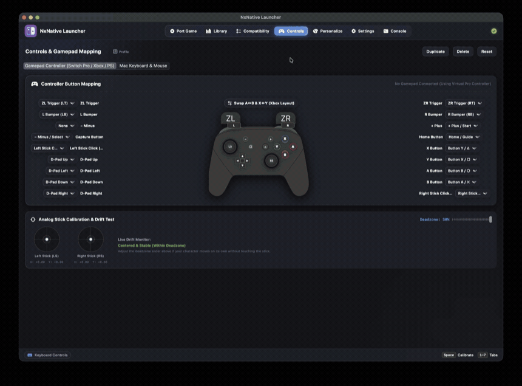
</p>

---

### 7. Engine Compatibility Patches & Upstream Synchronization
- **One-Click Engine Patches**: Apply title-specific memory allocator hooks, Unreal Engine allocator gates, and 60 FPS patches (e.g. Dragon Quest VII v0 metadata and dynamic shader fallback).
- **Git Commit Diffing**: Live upstream tracking comparing your local build with the newest commits of `seedds/nxnative`.

---

## ⚡ Quick Start Guide

### 🎮 For Gamers (Play in 60 Seconds)

1. **Download the Launcher**:
   - Grab the latest **`NxNative_Launcher.dmg`** from the [GitHub Releases](https://github.com/rennan101/nxnative_Launcher/releases).
   - Open the `.dmg` and drag **NxNative_Launcher.app** into your `/Applications` folder.
2. **Provide your Decryption Keys**:
   - Place your legally dumped **`prod.keys`** in `~/.switch/prod.keys` (or select it in the **Settings** tab).
3. **Port & Play**:
   - Switch to the **Port Game** tab, drag and drop your game folder, select **Mac App (.app)**, and click **Port Game**.
   - Head to the **Library** tab, connect your gamepad, and hit **Play Game**!

---

### 🛠️ For Developers (Build from Source)

```bash
# 1. Clone this repository with submodules
git clone https://github.com/rennan101/nxnative_Launcher.git
cd nxnative_Launcher

# 2. Build the Swift GUI application
cd gui
swift build -c release

# 3. Assemble the standalone .app bundle
cd ..
bash scripts/build_gui.sh

# 4. (Optional) Generate the distributable .dmg installer
bash scripts/create_dmg.sh
```

---

## 🛠️ Environment Setup & Prerequisites

### System Requirements
* **Hardware**: Apple Silicon (M1+ & A17+).
* **OS**: macOS 13.0 (Ventura), macOS 14.0 (Sonoma), macOS 15.0 (Sequoia) or newer.
* **Unified Memory**: 8 GB minimum (16 GB recommended for open-world titles like Zelda TotK).
* **Disk Space**: 20–50 GB free SSD space for RomFS extraction and shader caches.
* **Toolchain**: [Xcode](https://apps.apple.com/app/xcode/id497799835) 27.1, [Homebrew](https://brew.sh) and Python 3.12 or newer.

### Manual Dependency Installation (Terminal)
If you prefer configuring dependencies manually:
```bash
# Install Xcode Command Line Tools
xcode-select --install

# Install Homebrew dependencies (Python 3.12, 3.13, or 3.14 recommended)
brew install python@3.13 cmake ninja molten-vk libzip lz4 zstd spirv-cross xcodegen dotnet

# Install required Python packages for asset processing and shader translation
python3.13 -m pip install lz4 capstone fonttools

# (Optional) For compressed .nsz / .xcz files, install nsz (requires Python <= 3.14)
python3.13 -m pip install nsz
```

> [!NOTE]
> `libhac` is a .NET C# library managed via NuGet and compiled automatically by `dotnet` for `nx_extract`. It is **not** a Python package.

---

## 🚀 Step-by-Step Porting Tutorial

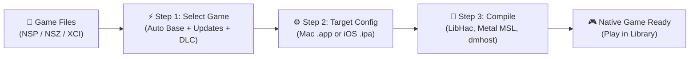

### Step 1: Drag & Drop Game Dumps
Drop your folder containing the base game, newest update, and DLCs. The launcher automatically matches Title IDs and verifies disk space:

<p align="center">
  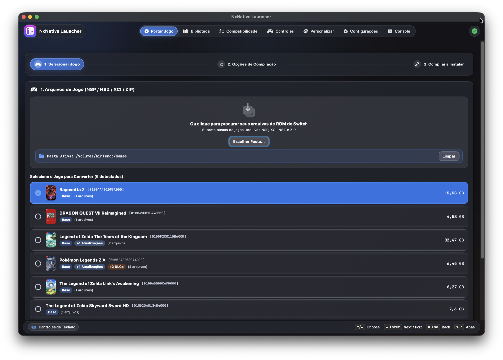
</p>

### Step 2: Configure Target & Enhancements
Select **Mac App (.app)** or **iOS IPA (.ipa)**, choose your destination folder, and enable **60 FPS Unlock** and **MetalFX Spatial Upscaling**:

<p align="center">
  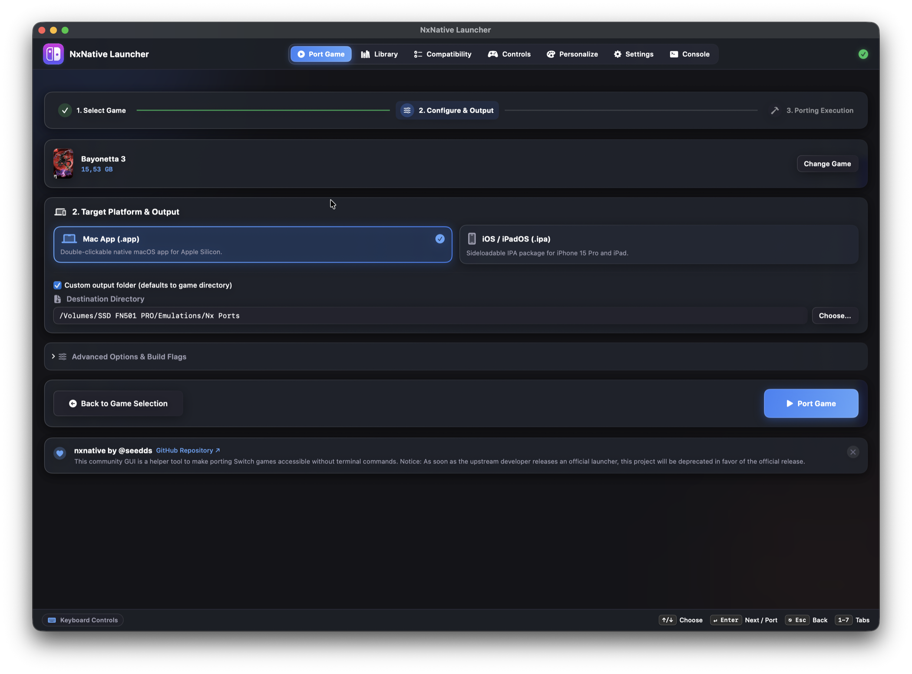
</p>

### Step 3: Multi-Stage Build & macOS Notification
Watch real-time extraction, shader compilation, and host linking. A native macOS banner notification will chime when compilation finishes:

<p align="center">
  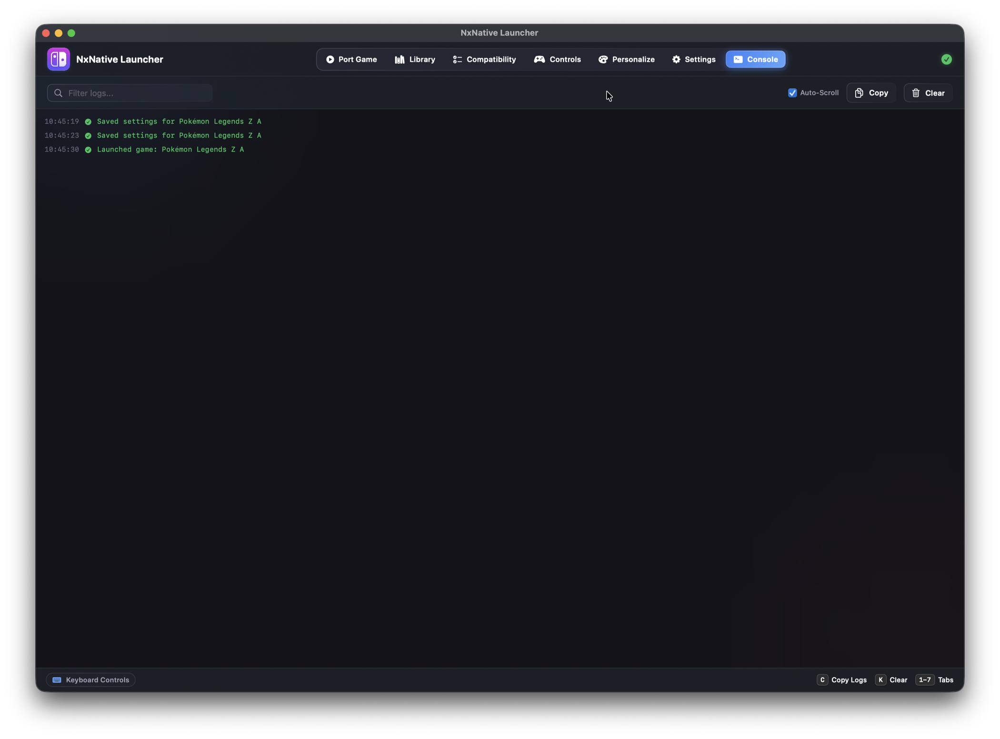
</p>

---

## 🕹️ How to Configure and Play Your Game

### How to play

1. **Launch from the Library**:
   - Highlight your game in the carousel using your gamepad or arrow keys, then press **`A` / `✕`** or **Enter**.
2. **Launch from Finder**:
   - The compiled game is a native macOS application bundle (`.app`). Simply double-click `<GameName>.app` in your destination folder!
3. **Per-Game Settings (`env.txt`)**:
   - Customize Framerate (30 vs 60 FPS Unlocked), Docked Mode (1080p) vs Handheld (720p), MetalFX Upscaling, and Metal HUD.
4. **Custom Box Art & Mods**:
   - Click **Options** to set custom covers or open the LayeredFS mods folder.

---

## 🎮 Gamepad Navigation Reference

| Action | Nintendo Switch | Xbox | PlayStation | Keyboard Shortcut |
| :--- | :---: | :---: | :---: | :---: |
| **Navigate Carousel / Lists** | D-Pad / Left Stick | D-Pad / Left Stick | D-Pad / Left Stick | Arrow Keys |
| **Play Game / Confirm** | **`A`** | **`A`** | **`✕`** | Return (Enter) |
| **Cancel / Return to Shelf** | **`B`** | **`B`** | **`○`** | Escape |
| **Open Options & Mods Deck** | **`X`** | **`X`** | **`□`** | `O` |
| **Open Save Files in Finder** | **`Y`** | **`Y`** | **`△`** | `S` |
| **Previous / Next Tab** | **`L` / `R`** | **`LB` / `RB`** | **`L1` / `R1`** | `[` / `]` |
| **Open Settings Menu** | **`+` (Plus)** | **Menu** | **Options** | `,` (Comma) |
| **Quick-Exit Game (Couch Mode)**| Hold **Home** (3s) | Hold **Guide** (3s) | Hold **PS** (3s) | `Cmd + Q` |

---

## 🗺️ Interactive Roadmap

Track our shipped milestones and upcoming features! Star the repository to follow development:

### ✅ Completed Milestones

- [x] **v1.0.0 — Foundation & Native Metal Execution**:
  - Direct Mach-O ARM64 rewriting and compilation on Apple Silicon.
  - Native Metal Shading Language (`.metal`) pipeline translation via SPIRV-Cross.
  - Horizon OS kernel service simulation & LibHac extraction.
  - Initial Swift graphical user interface.
- [x] **v1.4.0 — Switch Dark Mode UI & Authentic Cover Art**:
  - Full UI redesign inspired by the Nintendo Switch Dark Mode & CrossOver.
  - Panoramic 16:9 Hero section with dynamic specular neon rim lighting.
  - Official retail portrait box art (1 : 1.60 ratio) and dynamic game carousel.
  - Personalization tab with 8 dynamic neon highlight themes.
  - Compatibility Matrix with RAM requirement filters (4GB, 6GB, 8GB, 16GB).
- [x] **v1.5.0 — Dual-Tier Library & Pre-Flight Security**:
  - Two-tier library organization: Mac Native (`.app`) and iPhone / iPad (`.ipa`).
  - Automatic game bundling (Base + Update + DLCs) with disk space pre-flight calculation.
  - Cryptographic `KeyCheckService` validating `prod.keys` and NCA headers with AES-128-XTS.
  - Atmosphere LayeredFS mod integration (`<Game.app>/Contents/Resources/atmosphere/contents/<TID>/`).
- [x] **v1.5.1 — iOS Device Deployment & AirDrop**:
  - Real-time streaming progress feedback for iOS deployments via `xcrun devicectl`.
  - Native AirDrop sharing support for exported `.ipa` packages.
  - Deadlock prevention and background task safety.
- [x] **v1.6.0, v1.6.1 & v1.6.2 — Controller Remapping, Save Sync & Robust Environment Setup**:
  - **Full Controller Remapping**: Custom button mapping for Switch Pro, Joy-Cons, Xbox Series/One, and PS5 DualSense controllers with profile duplication and reset.
  - **Save Synchronization Service (`SaveSyncService`)**: Bidirectional save state synchronization and backup between Mac and paired iOS devices.
  - **Custom Cover Art**: User-customizable box art picker (`.jpg`, `.png`, `.webp`) with instant persistence and fallback reset.
  - **Automated Environment Diagnostics & Python 3.12+ / Pip Fix**: One-click sequential Homebrew and build dependency installer in Settings tab, with dynamic Python 3.12+ resolution and safe pip package installation.
  - **3-Second Couch Exit**: Global 3-second hold shortcut on Xbox Guide / PS / Home buttons to close running games and refocus the Launcher.
- [x] **v1.6.3 — In-App Multi-Language Localization (13 Languages)**:
  - **In-App Dynamic Language Switcher**: Switch the launcher UI language on the fly under the *Personalization* tab without restarting or altering macOS system preferences.
  - **13 Languages Supported**: English, Portuguese (Brazil), Spanish, French, German, Italian, Polish, Russian, Japanese, Korean, Simplified Chinese, Traditional Chinese, and Swedish (contributed by @yeager).
  - **Full UI Coverage**: Localized navigation, library cards, porting progress banners, action sheets, settings dialogs, controller remapping, and system tools.
- [x] **v1.7.0 (Current Version) — Smart iCloud Cross-Save & Single-Button Device Sync**:
  - **Automated Smart Cross-Save**: Timestamp-based bidirectional save synchronization between Mac, iCloud Drive (`com~apple~CloudDocs/nxnative_launcher`), and connected iOS devices.
  - **Single "Sync Save" Button**: Replaced manual "Push" and "Pull" buttons with a single 1-click automatic synchronization action localized in all 13 languages.
  - **Auto-Sync on Game Launch**: Automatically checks and synchronizes saves with connected iPhone/iPad devices before starting a game on Mac.
  - **Safety Backups & iCloud Cover Badging**: Generates instant safety backups before any file replacement, and renders custom high-res box art onto iCloud game folders in Finder.

---

### ⏳ In Active Development & Future Milestones

- [ ] **v1.8.0 — MetalFX Temporal Upscaler**: Temporal anti-aliasing and dynamic temporal scaling for demanding 3D games.
- [ ] **v1.8.0 — Haptic Feedback & Gamepad Vibration**: DualSense adaptive triggers & Switch Pro linear resonant actuator rumble.
- [ ] **v1.9.0 — Discord Rich Presence**: Real-time rich presence showing active title, in-game playtime, and FPS counters.

---

## ❓ Frequently Asked Questions (FAQ)

<details>
<summary><b>1. Why do I need <code>prod.keys</code> and where do I get them?</b></summary>
Nintendo Switch software binaries and RomFS containers are encrypted with cryptographic keys unique to the platform. To legally decrypt and run code you own, you must dump your keys from your personal Nintendo Switch console using tools like <a href="https://github.com/shchmue/Lockpick_RCM">Lockpick_RCM</a>. Place the file at <code>~/.switch/prod.keys</code>.
</details>

<details>
<summary><b>2. How does 60 FPS work without game speed-up bugs?</b></summary>
The launcher injects <code>DM_FPS_TARGET=60</code> via <code>env.txt</code>, interfacing with the engine's internal frame-stepping hooks (such as <code>fstep_tick</code> in Zelda titles) to uncap the framerate while maintaining normal game physics and audio timing.
</details>

<details>
<summary><b>3. Can I transfer my existing save files from a physical Switch or Ryujinx?</b></summary>
Yes! Saves are stored in plain unencrypted Horizon save formats at <code>~/Library/Application Support/nxnative/&lt;TitleID&gt;/save</code>. Simply click the <b>Saves</b> button in the launcher to reveal the directory in Finder and paste your save files.
</details>

<details>
<summary><b>4. How does Save Sync work between Mac and iOS devices?</b></summary>
NxNative Launcher uses <code>SaveSyncService</code> to detect paired iOS devices via <code>xcrun devicectl</code>. With v1.7.0, a single click on <b>Sync Save</b> automatically compares timestamps and synchronizes the newest save between your Mac, iCloud Drive, and iPhone 15 Pro / iPad. Saves are also verified and synchronized automatically whenever you launch a game with a connected device!
</details>

<details>
<summary><b>5. Does this run via Rosetta 2 or an emulator?</b></summary>
No! Nintendo Switch games use ARM64 binaries (AArch64). Apple Silicon processors (M1+ & A17+) run ARM64 instructions natively. NxNative recompiles and translates Horizon OS syscalls and Maxwell graphics into native macOS Mach-O binaries and Apple Metal Shading Language (`.metal`), resulting in near-native performance.
</details>

---

## 🏛️ Upstream Architecture & Community Lineage

This launcher stands on the shoulders of brilliant software engineering across the open-source community:

| Project | Author / Team | License | Role in NxNative |
| :--- | :--- | :---: | :--- |
| **[nxnative](https://github.com/seedds/nxnative)** | **seedds** | MIT | Core engine, NVN/Vulkan/OpenGL-to-Metal host, ARM64 NSO rewriter, shader library prebuilds. |
| **[d2r-mobile](https://github.com/jhaizhou-ops/d2r-mobile)** | jhaizhou-ops | MIT | Original native execution approach for Switch code on Apple Silicon. |
| **[Ryujinx](https://github.com/Ryujinx/Ryujinx)** | Ryujinx Team | MIT | Maxwell shader translator (`Ryujinx.Graphics.Shader`) and kernel synchronization reference. |
| **[Atmosphère](https://github.com/Atmosphere-NX/Atmosphere)** | SciresM & Team | GPLv2 | Mesosphère kernel synchronization semantics (address arbiter, condition variables). |
| **[LibHac](https://github.com/Thealexbarney/LibHac)** | Thealexbarney | MIT | NSP extraction and PFS/HFS layered filesystem handling (`dm/tools/nx_extract`). |
| **[SPIRV-Cross](https://github.com/KhronosGroup/SPIRV-Cross)** | Khronos Group | Apache-2.0 | SPIR-V to Metal Shading Language compilation. |
| **deko3d** | fincs | zlib | Low-level texture layout size calculation algorithm. |
| **yuzu** | yuzu Team | GPLv2 | Maxwell instruction encodings reference. |

---

# 🇧🇷 Guia em Português (PT-BR)

Bem-vindo ao guia oficial em português do **NxNative Launcher (v1.7.0)**! Esta seção contém tudo o que você precisa para configurar o ambiente, portar seus jogos, personalizar sua biblioteca, sincronizar saves e jogar com controles no Apple Silicon.

### 📑 Índice do Guia em Português
- [1. Configuração do Ambiente e Dependências](#1-configuração-do-ambiente-e-dependências)
- [2. Passo a Passo: Como Portar Jogos](#2-passo-a-passo-como-portar-jogos)
- [3. Configuração na Biblioteca, Saves e Mods](#3-configuração-na-biblioteca-saves-e-mods)
- [4. Remapeamento de Controles e Como Jogar](#4-remapeamento-de-controles-e-como-jogar)
- [5. Suporte e Relato de Erros](#5-suporte-e-relato-de-erros)

---

### 1. Configuração do Ambiente e Dependências

#### A. Requisitos de Sistema
- Dispositivo com processador **Apple Silicon** (M1+ ou A17+).
- macOS 13.0 (Ventura), 14.0 (Sonoma) ou 15.0 (Sequoia).
- Chaves de descriptografia **`prod.keys`** extraídas do seu próprio Nintendo Switch via Lockpick_RCM (salve em `~/.switch/prod.keys`).

#### B. Instalação Automática (Pelo Próprio Launcher)
1. Abra o **NxNative_Launcher.app**.
2. Vá até a aba **Settings** (pressione `6` ou use o botão `R` no controle).
3. Na seção de diagnóstico, clique em **"Install Missing"** ou **"Repair All"** para que o aplicativo instale os compiladores e ferramentas sequencialmente em segundo plano.

#### C. Instalação Manual via Terminal
Se preferir instalar manualmente pelo terminal:
```bash
# 1. Instalar as ferramentas de linha de comando do Xcode
xcode-select --install

# 2. Instalar dependências via Homebrew (Python 3.12, 3.13 ou 3.14 recomendados)
brew install python@3.13 cmake ninja molten-vk libzip lz4 zstd spirv-cross xcodegen dotnet

# 3. Instalar pacotes Python para extração de assets e tradução de shaders
python3.13 -m pip install lz4 capstone fonttools

# (Opcional) Para arquivos comprimidos .nsz / .xcz, instale o nsz (requer Python <= 3.14)
python3.13 -m pip install nsz
```

> [!NOTE]
> `libhac` é uma biblioteca .NET C# gerenciada via NuGet e compilada automaticamente pelo `dotnet` para o `nx_extract`. **Não** é um pacote Python.

---

### 2. Passo a Passo: Como Portar Jogos

1. **Passo 1: Selecionar Arquivos do Jogo**:
   - Reúna os arquivos do seu jogo em uma pasta (Jogo Base `.nsp`/`.xci`, Updates e DLCs).
   - Na aba **Port Game**, arraste a pasta para a área indicada.
   - O launcher agrupa os arquivos automaticamente, calcula o espaço necessário em disco e valida a integridade. Clique no card do jogo para confirmar.
2. **Passo 2: Configurar Plataforma de Destino**:
   - Escolha **Mac App (.app)** para rodar no macOS ou **iOS / iPadOS (.ipa)** para iPhone 15 Pro / iPad.
   - Defina a pasta de saída (padrão: `Nx Ports/`).
   - Ative o **60 FPS Unlock** e o **Apple MetalFX Spatial Upscaling**.
   - Clique em **"Port Game"**.
3. **Passo 3: Compilação e Notificação**:
   - O pipeline extrai o RomFS/ExeFS, traduz os shaders Maxwell para SPIR-V e Metal Shading Language (`.metal`), e compila o binário Mach-O.
   - Uma **notificação nativa do macOS com som e banner** avisará assim que o jogo estiver pronto!

---

### 3. Configuração na Biblioteca, Saves e Mods

1. **Capas Customizadas**:
   - Na aba **Library**, selecione o jogo e clique no botão **Options** (ou tecla `O` / botão `X` no controle).
   - Clique em **"Choose Custom Cover..."** e selecione qualquer imagem do seu Mac (`.jpg`, `.png`, `.webp`).
2. **Desempenho e 60 FPS por Jogo**:
   - Configure individualmente cada jogo via `env.txt`: Framerate Target (30 FPS vs 60 FPS Unlocked), Docked Mode (1080p) vs Handheld (720p), MetalFX Upscaling e painel Metal Performance HUD.
3. **Sincronização de Saves (Cross Save)**:
   - Os arquivos de progresso ficam gravados em:
     `~/Library/Application Support/nxnative/<TitleID>/save/`
   - Clique no botão **Saves** no launcher para abrir a pasta diretamente no Finder ou sincronizar com aparelhos iOS emparelhados via `SaveSyncService`. Com a versão v1.7.0, um clique no botão **Sincronizar Save** compara datas e sincroniza automaticamente a versão mais recente entre seu Mac, iCloud Drive e dispositivos iPhone/iPad! Além disso, a sincronização ocorre automaticamente ao iniciar o jogo no Mac.
4. **Mods de Jogo (LayeredFS / Atmosphere)**:
   - No painel de opções, acesse a pasta de mods: `<Game.app>/Contents/Resources/atmosphere/contents/<TitleID>/`.
   - Cole suas texturas HD, mods de física ou traduções em PT-BR.

---

### 4. Remapeamento de Controles e Como Jogar

- **Remapeamento Completo de Botões**:
  - Na aba **Controls**, você pode customizar cada botão do seu Switch Pro Controller, Joy-Cons, Xbox ou PS5 DualSense, além de configurar perfis para Teclado e Mouse.
- **Como Abrir o Jogo**:
  - Pelo Launcher: Aperte **`A` / `✕`** ou a tecla **Enter** sobre o jogo selecionado no carrossel.
  - Pelo Finder: Dê duplo clique no aplicativo autônomo `<NomeDoJogo>.app` na sua pasta `Nx Ports/`.
- **Atalho do Sofá para Sair**: Segure o botão central do seu controle (**Guide / PS / Home**) por **3 segundos** durante a gameplay para fechar o jogo com segurança e voltar ao Launcher!

---

### 5. Suporte e Relato de Erros

- 🚨 **Relatar Bug:** [Abrir Bug Report](https://github.com/rennan101/nxnative_Launcher/issues/new?template=bug_report.yml) ou participe do [Support Hub (Ticket #1)](https://github.com/rennan101/nxnative_Launcher/issues/1).
- 🎮 **Relatar Jogo Testado:** [Enviar Compatibilidade](https://github.com/rennan101/nxnative_Launcher/issues/new?template=game_compatibility.yml) ou consulte o [Compatibility Hub (Ticket #2)](https://github.com/rennan101/nxnative_Launcher/issues/2).
- 💡 **Sugerir Ideias:** [Sugerir Nova Feature](https://github.com/rennan101/nxnative_Launcher/issues/new?template=feature_request.yml).
- 🔄 **Sincronização Upstream:** O repositório possui uma GitHub Action que sincroniza automaticamente com as novidades de `seedds/nxnative`.

---

## ⚖️ Legal Disclaimer & Fair Use Notice

- **NxNative Launcher** is an open-source research and educational utility designed for interoperability and native software execution on Apple Silicon.
- **NO PROPRIETARY ASSETS DISTRIBUTED**: This software contains **no copyrighted code, binary assets, game data, or cryptographic keys** from Nintendo or any third-party game publishers.
- **BRING YOUR OWN KEYS & GAMES**: Users must supply their own legally obtained `prod.keys` dumped from their personal Nintendo Switch hardware, as well as their own game files dumped from cartridges or digital purchases they legally own.
- **TRADEMARKS**: Nintendo Switch is a registered trademark of Nintendo Co., Ltd. NxNative Launcher is an independent open-source project and is not affiliated with, endorsed by, or sponsored by Nintendo.
