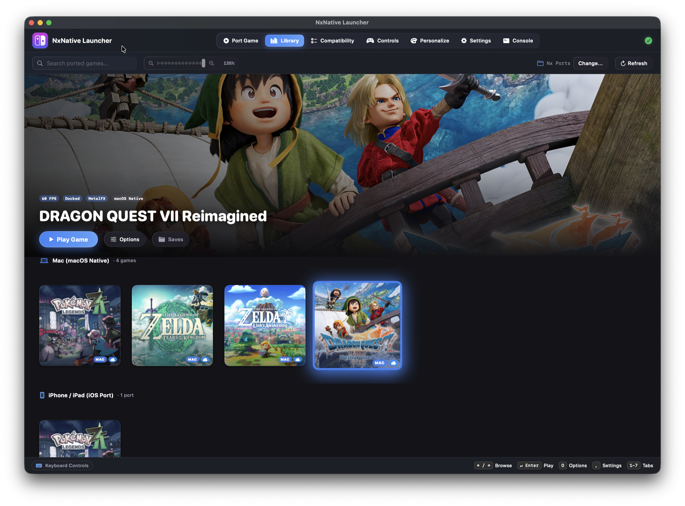
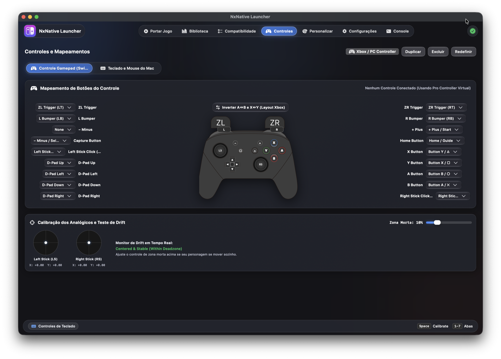
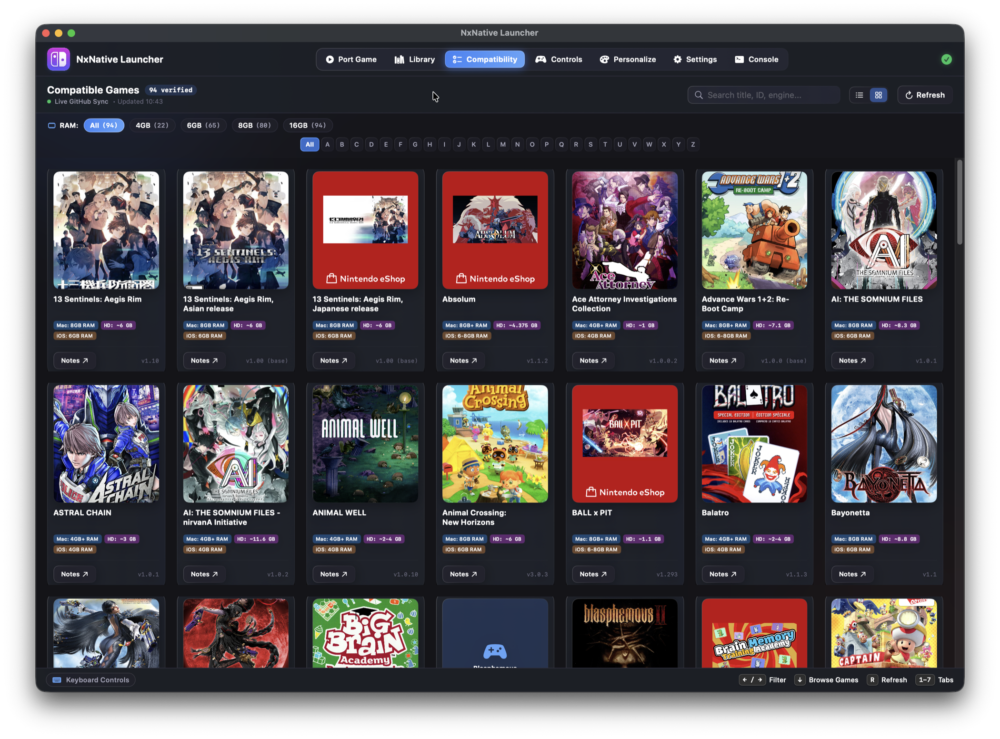
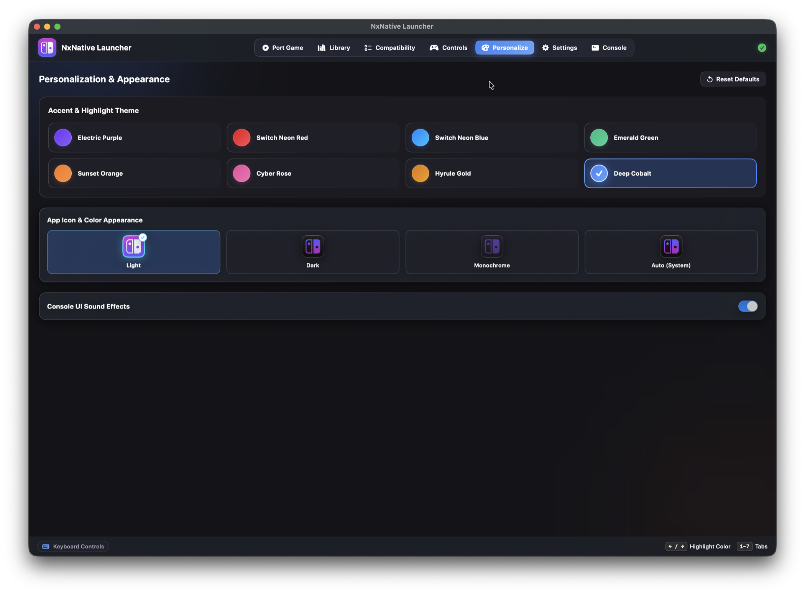
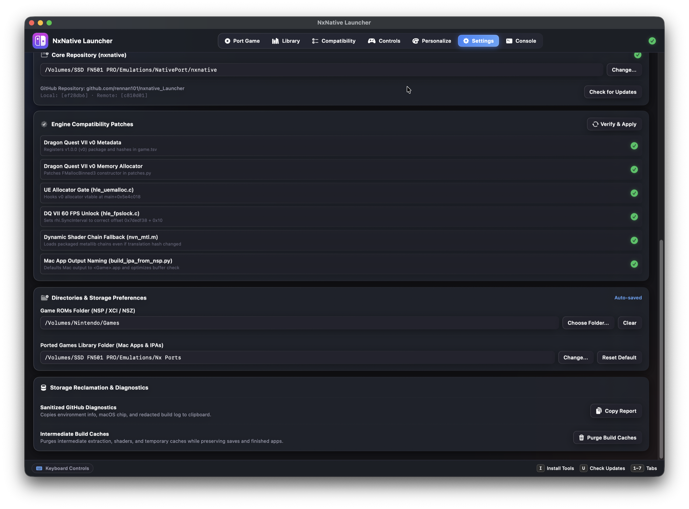
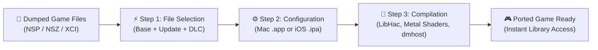

<p align="center">
  
</p>

# NxNative Launcher

### The Native Nintendo Switch Game Porting Suite & Console Game Library for Apple Silicon

[](https://apple.com/macos)
[-orange.svg)](https://apple.com)
[](https://swift.org)
[](https://github.com/rennan101/nxnative_Launcher/releases)
[](LICENSE)
[](https://github.com/seedds/nxnative)
[](https://github.com/rennan101/nxnative_Launcher/issues)
[](https://github.com/rennan101/nxnative_Launcher/actions/workflows/sync-upstream.yml)

> ### ❤️ Community Acknowledgement & Credits
> **NxNative Launcher** is an open-source native graphical interface and console-style game manager built directly on top of the breakthrough native translation engine created by **[seedds](https://github.com/seedds)** in **[nxnative](https://github.com/seedds/nxnative)**.
> All core translation, Metal host execution architecture, Horizon service simulation, and Maxwell-to-SPIR-V rewriters are developed and maintained by **seedds** and the open-source emulation and systems engineering community. We express our deepest gratitude to seedds for making native execution on Apple Silicon a reality!

<p align="center">
  
</p>

---

> [!IMPORTANT]
> ### ⚖️ ZERO COPYRIGHTED ASSETS DISTRIBUTED (Strict Clean-Room Policy)
> - **No Proprietary Keys**: This repository and application **DO NOT** contain, host, link to, or distribute any Nintendo cryptographic keys (`prod.keys`, `title.keys`), key seeds, or certificates. Users must dump their own keys from their personally owned Nintendo Switch hardware.
> - **No Games or ROMs**: **NO** game binaries, NSPs, XCIs, DLC files, game updates, or copyrighted assets are provided, distributed, or mirrored. Users must provide their own legally obtained game dumps.
> - **Independent Interoperability**: NxNative Launcher is purely an open-source graphical orchestration interface and utility tool built for Apple Silicon execution interoperability.

---

## 🌟 Overview & Key Features

NxNative Launcher transforms the technical command-line porting pipeline into a fluid, responsive, console-quality desktop application for Apple Silicon Macs (macOS 13+ Ventura, Sonoma, Sequoia, and later).

### 🕹️ 1. Console-Style Game Library
- **16:9 Hero Section & Cover Art Carousel**: Panoramic header displaying full widescreen game artwork with ambient neon specular rims (`NXTheme.specularRim`) and authentic box art in portrait proportion (1 : 1.60).
- **Two-Tier Library Categories**:
  - **Mac (macOS Native)**: Standalone compiled `.app` bundles executable on Apple Silicon Macs.
  - **iPhone / iPad (iOS Port)**: Sideloadable `.ipa` packages ready for direct deployment via `xcrun devicectl` or AirDrop.
- **iCloud Cross-Save Synchronization**: Seamless bidirectional save sync between macOS and iOS/iPadOS (`iCloud Drive/NxNative/Saves/<Game>`) with automated folder cover badges for instant visual identification in Finder and the Files app.
- **Real-Time Save Location**: Instant discovery of local save game folders (`~/Library/Application Support/nxnative/<TID>/save`) with single-click shortcuts to push to or pull from iCloud or connected devices.
- **Installed DLC & Update Detection**: Scans `<Game.app>/Contents/Resources/aoc` and lists installed expansions, version tags, and disk space usage.
- **Per-Game Settings Deck**: Quick toggles for 60 FPS Unlocked, Docked/Handheld mode, Apple MetalFX Spatial Upscaling, and Metal Performance HUD overlay.

<p align="center">
  
</p>

### 🎨 2. Custom Covers, Atmosphere Mods & LayeredFS
- **Custom Cover Art Picker**: Set any local `.jpg`, `.png`, or `.webp` as the game cover art via a native file picker, persisted to `~/Library/Application Support/nxnative/covers/` and automatically embedded into the `.app` bundle.
- **Game Mods (LayeredFS)**: Direct integration with Atmosphere-compatible game mods (`Contents/Resources/atmosphere/contents/<TitleID>/`). Modify game textures, physics, and localizations without modifying original game code.
- **One-Click Folder Access**: Instant shortcuts to open mods directories, save folders, and app bundle contents in Finder.

<p align="center">
  
</p>

### ⚡ 3. 3-Step Guided Porting Wizard
- **Step 1: Select Game Files**: Drag & drop any folder containing your `.nsp`, `.nsz`, `.xci`, or `.zip` dumps. The wizard automatically matches Title IDs and groups base games, updates, and DLC packs with an automated disk space pre-flight check.
- **Step 2: Configure & Output**:
  - Target Platform: Choose **Mac App (.app)** for macOS native play or **iOS / iPadOS (.ipa)** for iPhone 15 Pro / iPad devices.
  - Destination Directory: Specify your custom games directory (e.g. `Nx Ports/`).
  - Performance Enhancements: Enable 60 FPS unlock, MetalFX Spatial Upscaling, and debug flags.
- **Step 3: Multi-Stage Execution & Notifications**:
  - Live progress feedback through ExeFS extraction (LibHac), Maxwell-to-SPIR-V shader translation, SPIRV-Cross Metal compilation, and Mach-O linking (`dmhost`).
  - Native macOS banner notification and chime upon build completion.

<p align="center">
  
</p>

<p align="center">
  
</p>

### 🎮 4. Universal Gamepad Navigation & Button Remapping
- **Plug & Play Gamepad Support**: Native compatibility with **Nintendo Switch** (Joy-Cons & Pro Controller), **Xbox** (Series X/S, One, Bluetooth), **PlayStation** (DualShock 4 & DualSense PS5), **8BitDo**, and standard MFi / generic HID gamepads via Apple's native `GameController` framework.
- **Custom Button Remapping**: Rebind any controller button, trigger, or stick click with dedicated profile management (Gamepad Controller and Mac Keyboard & Mouse profiles).
- **Quick-Exit Game Shortcut**: Hold the **Xbox Guide / PS / Home** button for **3 seconds** during gameplay to safely exit the game and bring the Launcher back into focus.
- **Adaptive Glyphs & Sounds**: On-screen prompts match the connected controller type with mechanical tactile audio feedback (`NSSound`).

<p align="center">
  
</p>

### 📋 5. Compatibility Matrix (RAM Filters & Live GitHub Sync)
- **Verified Playable Games**: Live database synchronized directly with upstream compatibility reports.
- **RAM Requirement Filters**: Filter verified games instantly by Unified Memory: **All**, **4GB**, **6GB**, **8GB**, and **16GB**.
- **Hardware Requirement Badges**: Displays minimum Mac Unified Memory, iOS RAM, and required SSD storage space alongside tested game versions.

<p align="center">
  
</p>

### 🌈 6. Personalization & Neon Highlight Themes
- **8 Dynamic Accent Themes**: Switch Neon Red, Switch Neon Blue, Electric Purple, Sunset Orange, Emerald Green, Cyber Rose, Hyrule Gold, and Deep Cobalt.
- **Appearance Modes**: Light, Dark, Monochrome, and Auto (System).
- **Tactile UI Sound Effects**: Mechanical sound effects for button clicks, carousel navigation, and game launching (toggleable in Settings with built-in audio debouncing).

<p align="center">
  
</p>

### 🛠️ 7. Engine Compatibility Patches & Upstream Synchronization
- **Engine Patch Manager**: One-click verification and application of title-specific engine patches (e.g. Dragon Quest VII v0 metadata, memory allocator hooks, UE allocator gates, 60 FPS unlock, and dynamic shader fallback).
- **Upstream Sync Tracking**: Live Git commit diffing between your local installation and the latest remote commits of `seedds/nxnative`.
- **Directories & Storage Preferences**: Set default ROM folders and custom game build destinations.

<p align="center">
  
</p>

### 💻 8. Real-Time Live Console
- **Live Output Stream**: Real-time console logs of game launches, compilation pipeline steps, and environment events.
- **Log Management**: Filter logs by keyword, toggle auto-scroll, copy logs to clipboard, or clear the buffer.

<p align="center">
  
</p>

---

## 🛠️ Environment Setup & Dependencies Guide

Before compiling or executing ported games, ensure your macOS system is configured with the required command-line tools and runtime libraries.

### 📋 1. System Requirements
- **Hardware**: Any Mac computer powered by **Apple Silicon** (M1, M1 Pro/Max/Ultra, M2, M3, M4 or later).
- **Operating System**: **macOS 13.0 (Ventura)**, **macOS 14.0 (Sonoma)**, **macOS 15.0 (Sequoia)** or newer.
- **Unified Memory**: 8 GB recommended (minimum 4 GB for lightweight 2D games; 16 GB recommended for demanding open-world titles like Zelda TotK).
- **Storage Space**: High-speed SSD with at least 20 to 50 GB free for RomFS extraction, shader compilation, and intermediate builds.

---

### 🔑 2. Decryption Keys (`prod.keys`)
> [!IMPORTANT]
> NxNative requires **`prod.keys`** to decrypt Nintendo Switch NCA archives and executable binaries. In compliance with intellectual property laws, **no keys are provided or distributed with this project**.
>
> 1. Dump your personal keys from your own modded Nintendo Switch hardware using the homebrew tool **[Lockpick_RCM](https://github.com/shchmue/Lockpick_RCM)**.
> 2. Place your dumped `prod.keys` into:
>    ```bash
>    mkdir -p ~/.switch
>    cp /path/to/your/prod.keys ~/.switch/prod.keys
>    ```
> 3. Alternatively, you can browse and set your custom keys file directly in the **Settings** tab within NxNative Launcher.

---

### ⚙️ 3. Automatic Setup (Via Launcher Interface)
1. Download and open **`NxNative_Launcher.app`**.
2. Navigate to the **Settings** tab (press `6` on your keyboard or `R` on a connected controller).
3. Under the **System Build Tools & Compilers** section:
   - If Homebrew, Command Line Tools, Python modules, .NET, or any required compilers show missing items, click **"Install All One by One"** or **"Install All Dependencies"**.
   - The launcher installs Homebrew (with automatic macOS sudo authentication) and then installs all missing tools sequentially one by one until completed.

---

### 💻 4. Manual Setup (Terminal / Command Line)
If you prefer configuring your development environment manually via the terminal:

#### Step A: Install Xcode Command Line Tools
```bash
xcode-select --install
```

#### Step B: Install Homebrew Package Manager
If [Homebrew](https://brew.sh) is not yet installed:
```bash
/bin/bash -c "$(curl -fsSL https://raw.githubusercontent.com/Homebrew/install/HEAD/install.sh)"
```

#### Step C: Install Compilers and Support Libraries
Install required libraries for package extraction, compression codecs, and SPIR-V shader compilation:
```bash
brew install python@3.11 cmake ninja molten-vk libzip lz4 zstd spirv-cross
```

#### Step D: Install Python Runtime Dependencies
```bash
pip3 install pycryptodome libhac
```

---

## 🚀 Step-by-Step: Porting Games to Mac and iOS

With your environment configured and `prod.keys` in place, porting your games is streamlined into three guided steps:



### Step 1: Select Game Files
1. Create a folder containing your dumped game files (e.g., inside your `Games` directory or on an external SSD).
2. Ensure the matching files are present:
   - Base Game (`.nsp`, `.nsz`, or `.xci`)
   - Latest Game Update (`[v...] .nsp`)
   - Optional DLC Packages (`.nsp`, if available)
3. Open **NxNative Launcher** and click the **Port Game** tab (or press `1`).
4. Drag and drop the folder into the designated drop zone (or click **"Choose Folder..."**).
5. The Launcher automatically parses Title IDs, calculates required storage, and groups updates and DLCs with the base game:
   - Click on the detected game card to select it.

<p align="center">
  
</p>

---

### Step 2: Configure Target Platform and Options
1. Once selected, proceed to **Target Platform & Output**:
   - **Target Platform**:
     - Select **Mac App (.app)** for direct macOS native execution with full Metal hardware acceleration.
     - Select **iOS / iPadOS (.ipa)** to export a sideloadable IPA bundle for iPhone 15 Pro / iPad.
   - **Destination Directory**:
     - Default output directory is `Nx Ports/` (or click **"Choose..."** to specify a custom folder).
   - **Performance Enhancements**:
     - Enable **60 FPS Unlock** to release frame caps.
     - Enable **MetalFX Spatial Upscaling** for crisp neural super-resolution on high-DPI displays.
2. Click **"Port Game"**.

<p align="center">
  
</p>

---

### Step 3: Automated Compilation & Progress
1. The automated pipeline executes in real time:
   - **Stage 1 (Survey)**: NCA header inspection and game manifests validation.
   - **Stage 2 (Extraction)**: ExeFS and RomFS extraction via `LibHac`.
   - **Stage 3 (Shaders)**: Maxwell microcode decompilation into SPIR-V intermediates.
   - **Stage 4 (Metal MSL)**: SPIR-V translation to Metal Shading Language (`.metal`) via SPIRV-Cross.
   - **Stage 5 (Host Linking)**: Mach-O host binary linking (`dmhost`) and `.app` bundle assembly.
2. Monitor real-time compiler output directly in the **Console** tab:

<p align="center">
  
</p>

3. Once compilation finishes, macOS displays a **native notification banner with audio chime**, confirming that your game is ready to play!

---

## 🕹️ Configuring Games in Your Library

Ported games appear immediately in the **Library** tab. Customize appearance, mods, save sync, and runtime performance individually:

### 🖼️ 1. Custom Cover Art
1. In the **Library** tab, navigate to the desired game card in the carousel.
2. Click **Options** (or press `X` / `□` on a controller).
3. In the cover art section, click **"Choose Custom Cover..."**.
4. Select any local image (`.jpg`, `.png`, or `.webp`).
5. The cover is cached and embedded directly into the application bundle. Click *Reset to Official* to restore defaults at any time.

### ☁️ 2. iCloud Cross-Save Synchronization
- **One-Click Cloud Sync**: Sync game progress seamlessly between Mac and iPhone/iPad via `iCloud Drive/NxNative/Saves/<Game>`.
- **Folder Badges**: Cover art is automatically embedded as a custom folder badge in iCloud Drive for intuitive Finder and iOS Files navigation.
- **Push & Pull Controls**: Easily upload your local Mac save to iCloud or download cloud saves with timestamps and collision protection.

### ⚡ 3. Frame Rate (60 FPS) and Graphics Options
Each game maintains its personal execution environment file at `~/Library/Application Support/nxnative/<TitleID>/env.txt`:
- **Framerate Target**: Toggle between default 30 FPS and **60 FPS (Unlocked)** with smooth VSync.
- **Docked Mode**: Toggle between TV/Docked mode (native 1080p) and Handheld mode (720p for optimized MacBook battery life).
- **MetalFX Spatial Scaler**: Apple's hardware-accelerated spatial upscaler enhancing clarity while maintaining high frame rates.
- **Metal Performance HUD**: Toggle Apple's official telemetry overlay to inspect real-time FPS, GPU frame times, and memory usage.

<p align="center">
  
</p>

### 🧩 4. Atmosphere Mods & LayeredFS
NxNative natively supports Atmosphere-compatible LayeredFS mod structures:
1. In the game's **Options** sheet, scroll to **Game Mods (LayeredFS)**.
2. Click **Reveal Mods Folder** to open:
   `<Game.app>/Contents/Resources/atmosphere/contents/<TitleID>/`
3. Paste compatible mod files (high-resolution textures, custom audio, community translations, or physics patches).
4. The game automatically mounts and loads modified assets upon startup.

### 💾 5. Save Game Locations & Backups
- Local saves are stored in standard macOS application support directories:
  `~/Library/Application Support/nxnative/<TitleID>/save/`
- Click **"Saves"** on any game card to open the directory directly in Finder for manual backups.

<p align="center">
  
</p>

---

## 🎮 Launching and Playing Games

Launch games using either of two methods:

### Method 1: Directly from NxNative Launcher
1. Connect your preferred controller (Nintendo Switch Pro, Joy-Cons, Xbox Wireless, PS5 DualSense) or use the keyboard.
2. In the **Library** tab, navigate to your desired game using the **D-Pad / Analog Sticks** or **Arrow Keys**.
3. Press **`A`** (Nintendo / Xbox), **`✕`** (PlayStation), or **Return (Enter)** (or click **"Play Game"** with the mouse).
4. The launcher provides tactile audio confirmation and guards against duplicate background instances.

<p align="center">
  
</p>

### Method 2: Via macOS Finder
- Every ported game is a standalone, native macOS `.app` bundle.
- In Finder, navigate to your output folder (e.g., `Nx Ports/`) and double-click `<GameName>.app`.
- The game launches immediately, reading all preferences configured in `env.txt`.

> [!TIP]
> **Controller Quick-Exit Shortcut**:
> While playing a game with a gamepad, hold the **Xbox Guide / PS / Home** button for **3 seconds** to exit the game cleanly and return immediate focus to NxNative Launcher!

---

## 🎮 Gamepad Navigation & Controller Mapping Reference

| Action in Launcher | Nintendo Switch | Xbox | PlayStation | Keyboard Shortcut |
| :--- | :---: | :---: | :---: | :---: |
| **Navigate Carousel / Shelves** | D-Pad / Analog Stick | D-Pad / Analog Stick | D-Pad / Analog Stick | Arrow Keys |
| **Play / Confirm Selection** | **`A`** | **`A`** | **`✕`** | Return (Enter) |
| **Cancel / Back** | **`B`** | **`B`** | **`○`** | Escape |
| **Open Options & Mods** | **`X`** | **`X`** | **`□`** | `O` |
| **Open Saves Folder** | **`Y`** | **`Y`** | **`△`** | `S` |
| **Previous Tab** | **`L`** | **`LB`** | **`L1`** | `[` or `Q` |
| **Next Tab** | **`R`** | **`RB`** | **`R1`** | `]` or `E` |
| **Open Settings** | **`+` (Plus)** | **Menu** | **Options** | `,` (Comma) |
| **Quick Exit Game** | Hold **Home** (3s) | Hold **Guide** (3s) | Hold **PS** (3s) | `Cmd + Q` |

---

## 🛠️ Building NxNative Launcher from Source

To compile the latest launcher binary from source code:

```bash
# 1. Clone repository
git clone https://github.com/rennan101/nxnative_Launcher.git
cd nxnative_Launcher

# 2. Build Swift GUI application in release mode
cd gui
swift build -c release

# 3. Assemble and code-sign .app bundle
cd ..
bash scripts/build_gui.sh

# 4. (Optional) Generate distributable .dmg installer
bash scripts/create_dmg.sh
```

Compiled deliverables `NxNative_Launcher.app` and `NxNative_Launcher.dmg` will be generated in the project root directory.

---

## 💬 Community Support, Bug Reports & Feature Requests

Encountered an issue, controller quirk, or want to submit game compatibility findings?
- 🚨 **Bug Reports:** [Submit a Bug Report](https://github.com/rennan101/nxnative_Launcher/issues/new?template=bug_report.yml) or join the conversation on the [Support Hub (Issue #1)](https://github.com/rennan101/nxnative_Launcher/issues/1).
- 🎮 **Game Compatibility:** [Submit a Compatibility Report](https://github.com/rennan101/nxnative_Launcher/issues/new?template=game_compatibility.yml) or share notes on the [Compatibility Hub (Issue #2)](https://github.com/rennan101/nxnative_Launcher/issues/2).
- 💡 **Feature Requests:** [Propose a Feature](https://github.com/rennan101/nxnative_Launcher/issues/new?template=feature_request.yml).
- 🔄 **Upstream Sync:** Automated GitHub Actions run daily to incorporate updates from `seedds/nxnative` safely. You can also trigger a local sync anytime with `./scripts/sync_upstream.sh`.

---

## 🏛️ Upstream Architecture & Community Lineage

This launcher stands on the shoulders of brilliant software engineering across the open-source emulation and systems community:

| Project | Author / Team | License | Role in NxNative |
| :--- | :--- | :---: | :--- |
| **[nxnative](https://github.com/seedds/nxnative)** | **seedds** | MIT | Core engine, NVN/Vulkan/OpenGL-to-Metal host, ARM64 NSO rewriter, shader library prebuilds. |
| **[d2r-mobile](https://github.com/jhaizhou-ops/d2r-mobile)** | jhaizhou-ops | MIT | Original native execution approach for Switch code on Apple Silicon. |
| **[Ryujinx](https://github.com/Ryujinx/Ryujinx)** | Ryujinx Team | MIT | Maxwell shader translator (`Ryujinx.Graphics.Shader`) and kernel synchronization reference. |
| **[Atmosphère](https://github.com/Atmosphere-NX/Atmosphere)** | SciresM & Team | GPLv2 | Mesosphère kernel synchronization semantics (address arbiter, condition variables). |
| **[LibHac](https://github.com/Thealexbarney/LibHac)** | Thealexbarney | MIT | NSP extraction and PFS/HFS layered filesystem handling (`dm/tools/nx_extract`). |
| **[SPIRV-Cross](https://github.com/KhronosGroup/SPIRV-Cross)** | Khronos Group | Apache-2.0 | SPIR-V to Metal Shading Language compilation. |
| **deko3d** | fincs | zlib | Low-level texture layout size calculation algorithm. |
| **yuzu** | yuzu Team | GPLv2 | Maxwell instruction encodings reference. |

---

## ⚖️ Legal Disclaimer & Fair Use Notice

- **NxNative Launcher** is an open-source research and educational utility designed for interoperability and native software execution on Apple Silicon.
- **NO PROPRIETARY ASSETS DISTRIBUTED**: This software contains **no copyrighted code, binary assets, game data, or cryptographic keys** from Nintendo or any third-party game publishers.
- **BRING YOUR OWN KEYS & GAMES**: Users must supply their own legally obtained `prod.keys` dumped from their personal Nintendo Switch hardware, as well as their own game files dumped from cartridges or digital purchases they legally own.
- **TRADEMARKS**: Nintendo Switch is a registered trademark of Nintendo Co., Ltd. NxNative Launcher is an independent open-source project and is not affiliated with, endorsed by, or sponsored by Nintendo.
