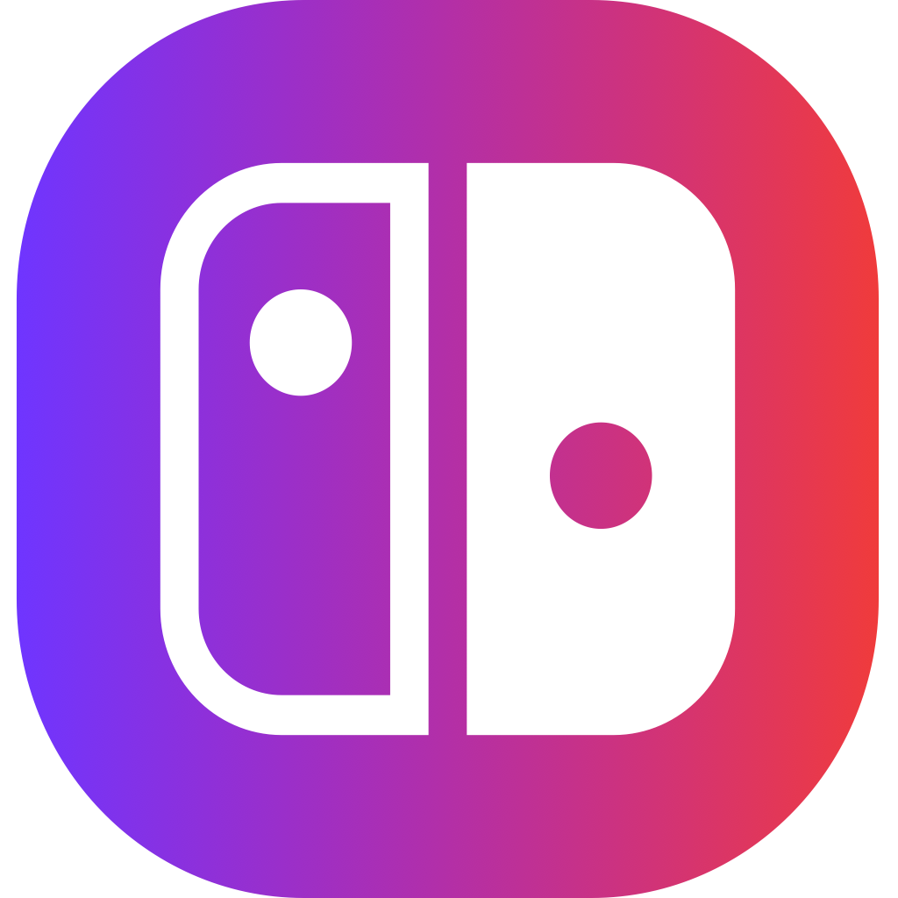

<p align="center">
  
</p>

# NxNative Launcher

### The Native Nintendo Switch Game Porting Suite & Console Game Library for Apple Silicon

[](https://apple.com/macos)
[-orange.svg)](https://apple.com)
[](https://swift.org)
[](LICENSE)
[](https://github.com/seedds/nxnative)

> ### ❤️ Community Acknowledgement & Credits
> **NxNative Launcher** is an open-source native graphical interface and console-style game manager built directly on top of the breakthrough native translation engine created by **[seedds](https://github.com/seedds)** in **[nxnative](https://github.com/seedds/nxnative)**.
> All core translation, Metal host execution architecture, Horizon service simulation, and Maxwell-to-SPIR-V rewriters are developed and maintained by **seedds** and the open-source emulation and systems engineering community. We express our deepest gratitude to seedds for making native execution on Apple Silicon a reality!

---

## 🌟 Overview & Key Features

NxNative Launcher transforms the technical command-line porting pipeline into a fluid, responsive, console-quality desktop application for Apple Silicon Macs (macOS 13+ Ventura, Sonoma, Sequoia, and later).

### 🎮 1. Universal Gamepad Navigation
Control the entire launcher directly from your couch with your favorite controller:
- **Plug & Play Support**: Native compatibility with **Nintendo Switch** (Joy-Cons individual/pair & Switch Pro Controller), **Xbox** (Series S/X, One, Bluetooth), **PlayStation** (DualShock 4 & DualSense PS5), **8BitDo** (Bluetooth & 2.4G), and standard MFi / generic HID gamepads via Apple's native `GameController` framework.
- **Adaptive Button Prompts**: Bottom prompt bar dynamically reflects the glyphs of the connected controller (A/B/X/Y for Nintendo and Xbox, ✕/○/□/△ for PlayStation).
- **Smooth Navigation**: D-Pad and analog stick navigation with configurable stick deadzone (`0.35`) and debounce throttling to eliminate stick drift and unwanted skips.
- **Shoulder Bumper Tab Switching**: Quick cycling across tabs using `L / R` (`LB / RB` or `L1 / R1`).

### 🕹️ 2. Console-Style Game Library (CrossOver & Console Experience)
- **Cover Art Hero Carousel**: Fluid horizontal shelf highlighting game box art with elevated focus (1.05x scale), ambient neon rim lighting, and active "Launching / Playing" status badges.
- **Focused Game Detail Deck**:
  - **Single-Click Play**: Big launch button featuring an asynchronous loading spinner and anti-double-click lockout to prevent duplicate instances.
  - **Installed DLC Detection**: Automatically scans `<Game.app>/Contents/Resources/aoc` and lists installed expansion packs with their names and disk sizes.
  - **Save Files Location**: Resolves and displays the exact save directory (`~/Library/Application Support/nxnative/<TID>/save`) with a one-click **"Open Folder"** button to reveal in Finder.
  - **Storage Breakdown**: Displays real-time disk consumption for the compiled bundle.
  - **Per-Game Settings**: Instant toggle for 60 FPS unlock, Docked/Handheld mode, MetalFX Spatial Upscaling, and Metal HUD.

### ⚡ 3. 3-Step Guided Porting Wizard
- **Step 1: Select Game**: Drag & drop any folder containing your `.nsp`, `.nsz`, `.xci`, or `.zip` dumps. The wizard automatically groups base games, game updates, and DLC packs.
- **Step 2: Configure & Output**: Pick your target platform (**Mac Native App** or **iOS IPA**), select target volume/folder, and configure performance enhancements (60 FPS unlock, MetalFX).
- **Step 3: Porting & Multi-Stage Execution**: Watch live stage progress (Survey, ExeFS extraction, RomFS synthesis, Metal shader pipeline generation, and host compilation).

### 🔔 4. Native Apple System Notifications
- Integration with macOS `UserNotifications`: receive immediate audible and banner notifications when your game port finishes compiling or if a build error occurs, allowing you to background the porting process and do other work.

### 🔊 5. Tactile UI Sound Effects
- Mechanical, low-latency audio feedback (`NSSound`) on button clicks, tab transitions, game carousel focus changes, and game launching (can be toggled on/off in Settings).

### 📋 6. Compatibility Matrix (List & Grid Views)
- Browse verified playable games with live GitHub synchronization.
- Filter by engine (Unreal, Unity, Nintendo/Sead, RE Engine) or search by Title ID.
- Toggle between **Detailed List View** and **Console Grid Card View**.

### 🛠️ 7. Automated Environment Diagnostics
- One-click diagnosis and installer for Xcode Command Line Tools, Python, Clang, Homebrew dependencies, and decryption keys (`prod.keys`).

---

## 🚀 Step-by-Step Tutorial: How to Port a Game

### Prerequisites
1. An **Apple Silicon Mac** (M1, M2, M3, M4 or newer) running **macOS 13.0 or later**.
2. Your **`prod.keys`** file dumped from your own Nintendo Switch console.
3. Your legally dumped game files (`.nsp`, `.nsz`, or `.xci`).

---

### Step 1: Initial Environment Check
1. Open **NxNative_Launcher.app**.
2. Navigate to the **Settings** tab (press `4` or use `R` bumper on your gamepad).
3. Under **Environment & Decryption Keys**:
   - Ensure your `prod.keys` path is configured (or drop your `prod.keys` onto the field).
   - If any compiler tools are marked in yellow or red, click **"Install Missing"** or **"Repair All"**.

---

### Step 2: Select Your Game Files
1. Switch to the **Port Game** tab.
2. Under **Step 1: Select Game Files**:
   - Click **"Select Folder"** or drag-and-drop a folder holding your game dumps.
   - If your folder contains multiple files (e.g., Base game + Update 1.2.0 + DLCs), NxNative Launcher automatically categorizes and links them.
   - Click on the detected game card to confirm your selection.
   - Click **"Continue to Configuration →"**.

---

### Step 3: Configure Target & Performance Options
1. Under **Step 2: Configure & Output**:
   - **Target Platform**: Select **Mac App (.app)** to play natively on your Mac.
   - **60 FPS Unlock**: Enable to run 30 FPS Switch games at 60 FPS (for titles with supported profiles such as Zelda BOTW, Mario Odyssey, Dragon Quest, etc.).
   - **MetalFX Upscaling**: Enable for Apple Silicon hardware-accelerated spatial upscaling.
   - **Docked Mode**: Toggle between 1080p Docked or 720p Handheld performance profiles.
   - **Output Location**: Defaults to your launcher's `Games/` directory.

---

### Step 4: Build Port
1. Click **"Build Port"**.
2. The launcher initiates the conversion process:
   - Stage 1: Surveying code modules and RomFS manifest.
   - Stage 2: ExeFS & code extraction with LibHac.
   - Stage 3: Maxwell shader translation into SPIR-V.
   - Stage 4: SPIRV-Cross translation into Metal Shading Language (`.metal`).
   - Stage 5: Native Mac host compilation (`dmhost`) and bundle packaging.
3. Once completed, a native **Apple Notification** will chime confirming the port is ready!

---

### Step 5: Play in the Console Library
1. Switch to the **Library** tab.
2. Your newly ported game will appear in the carousel with its official icon.
3. Connect your gamepad or use your mouse:
   - Use **D-Pad Left/Right** or analog stick to select your game.
   - Press **`A` / `✕`** or click **"Play Game"**.
   - Inspect installed DLCs or click **"Open Folder"** under Save Files to backup or inspect your save data!

---

## 🎮 Gamepad Navigation Reference

| Action | Nintendo Switch | Xbox | PlayStation | Keyboard Shortcut |
| :--- | :---: | :---: | :---: | :---: |
| **Navigate Carousel / List** | D-Pad / Left Stick | D-Pad / Left Stick | D-Pad / Left Stick | Arrow Keys |
| **Confirm / Play Game** | **`A`** | **`A`** | **`✕`** | Return (Enter) |
| **Cancel / Return to Shelf** | **`B`** | **`B`** | **`○`** | Escape |
| **Open Game Settings** | **`X`** | **`X`** | **`□`** | `S` |
| **Open Save Files Folder** | **`Y`** | **`Y`** | **`△`** | `O` |
| **Previous Tab** | **`L`** | **`LB`** | **`L1`** | `[` |
| **Next Tab** | **`R`** | **`RB`** | **`R1`** | `]` |
| **Open Settings Menu** | **`+` (Plus)** | **Menu** | **Options** | `,` (Comma) |

---

## 🛠️ Building NxNative Launcher from Source

### Prerequisites
- macOS 13+ with Xcode 15+ or Command Line Tools installed.
- Swift 5.9+.

```bash
# 1. Clone this repository
git clone https://github.com/rennan101/nxnative_Launcher.git
cd nxnative_Launcher

# 2. Build the Swift GUI application
cd gui
swift build -c release

# 3. Create the standalone signed .app bundle
cd ..
bash scripts/build_gui.sh

# 4. Optional: Create a distributable .dmg installer
bash scripts/create_dmg.sh
```

The compiled `NxNative_Launcher.app` will be created in your workspace root, ready to run.

---

## 🏛️ Upstream Architecture & Community Lineage

This launcher stands on the shoulders of brilliant software engineering across the open-source emulation and systems community:

| Project | Author / Team | License | Role in NxNative |
| :--- | :--- | :---: | :--- |
| **[nxnative](https://github.com/seedds/nxnative)** | **seedds** | MIT | Core engine, NVN/Vulkan/OpenGL-to-Metal host, ARM64 NSO rewriter, shader library prebuilds. |
| **[d2r-mobile](https://github.com/jhaizhou-ops/d2r-mobile)** | jhaizhou-ops | MIT | Original native execution approach for Switch code on Apple Silicon. |
| **[Ryujinx](https://github.com/Ryujinx/Ryujinx)** | Ryujinx Team | MIT | Maxwell shader translator (`Ryujinx.Graphics.Shader`) and kernel synchronization reference. |
| **[Atmosphère](https://github.com/Atmosphere-NX/Atmosphere)** | SciresM & Team | GPLv2 | Mesosphère kernel synchronization semantics (address arbiter, condition variables). |
| **[LibHac](https://github.com/Thealexbarney/LibHac)** | Thealexbarney | MIT | NSP extraction and PFS/HFS layered filesystem handling (`dm/tools/nx_extract`). |
| **[SPIRV-Cross](https://github.com/KhronosGroup/SPIRV-Cross)** | Khronos Group | Apache-2.0 | SPIR-V to Metal Shading Language compilation. |
| **deko3d** | fincs | zlib | Low-level texture layout size calculation algorithm. |
| **yuzu** | yuzu Team | GPLv2 | Maxwell instruction encodings reference. |

---

## ⚖️ Legal Disclaimer

- **NxNative Launcher** is an open-source research and educational utility designed for interoperability and native software execution on Apple Silicon.
- This software contains **no copyrighted code, binary assets, game data, or cryptographic keys** from Nintendo or any third-party game publishers.
- Users must supply their own legally obtained `prod.keys` dumped from their personal Nintendo Switch hardware, as well as their own game files dumped from cartridges or digital purchases they legally own.
- Nintendo Switch is a registered trademark of Nintendo Co., Ltd. NxNative Launcher is an independent open-source project and is not affiliated with, endorsed by, or sponsored by Nintendo.
