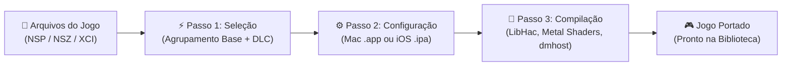

<p align="center">
  
</p>

# NxNative Launcher

### The Native Nintendo Switch Game Porting Suite & Console Game Library for Apple Silicon

[](https://apple.com/macos)
[-orange.svg)](https://apple.com)
[](https://swift.org)
[](https://github.com/rennan101/nxnative_Launcher/releases)
[](LICENSE)
[](https://github.com/seedds/nxnative)
[](https://github.com/rennan101/nxnative_Launcher/issues)
[](https://github.com/rennan101/nxnative_Launcher/actions/workflows/sync-upstream.yml)

> ### ❤️ Community Acknowledgement & Credits
> **NxNative Launcher** is an open-source native graphical interface and console-style game manager built directly on top of the breakthrough native translation engine created by **[seedds](https://github.com/seedds)** in **[nxnative](https://github.com/seedds/nxnative)**.
> All core translation, Metal host execution architecture, Horizon service simulation, and Maxwell-to-SPIR-V rewriters are developed and maintained by **seedds** and the open-source emulation and systems engineering community. We express our deepest gratitude to seedds for making native execution on Apple Silicon a reality!

<p align="center">
  
</p>

---

> [!IMPORTANT]
> ### ⚖️ ZERO COPYRIGHTED ASSETS DISTRIBUTED (Strict Clean-Room Policy)
> - **No Proprietary Keys**: This repository and application **DO NOT** contain, host, link to, or distribute any Nintendo cryptographic keys (`prod.keys`, `title.keys`), key seeds, or certificates. Users must dump their own keys from their personally owned Nintendo Switch hardware.
> - **No Games or ROMs**: **NO** game binaries, NSPs, XCIs, DLC files, game updates, or copyrighted assets are provided, distributed, or mirrored. Users must provide their own legally obtained game dumps.
> - **Independent Interoperability**: NxNative Launcher is purely an open-source graphical orchestration interface and utility tool built for Apple Silicon execution interoperability.

---

## 🌟 Overview & Key Features

NxNative Launcher transforms the technical command-line porting pipeline into a fluid, responsive, console-quality desktop application for Apple Silicon Macs (macOS 13+ Ventura, Sonoma, Sequoia, and later).

### 🕹️ 1. Console-Style Game Library (Switch Dark Mode & CrossOver Experience)
- **16:9 Hero Section & Cover Art Carousel**: Panoramic header displaying full widescreen game artwork with ambient neon specular rims (`NXTheme.specularRim`) and authentic box art in portrait proportion (1 : 1.60).
- **Two-Tier Library Categories**:
  - **Mac (macOS Native)**: Standalone compiled `.app` bundles executable on Apple Silicon Macs.
  - **iPhone / iPad (iOS Port)**: Sideloadable `.ipa` packages ready for direct deployment via `xcrun devicectl` or AirDrop.
- **Real-Time Save Location**: Instant discovery of save game folders (`~/Library/Application Support/nxnative/<TID>/save`) with a single-click **"Saves"** button to reveal in Finder.
- **Installed DLC & Update Detection**: Scans `<Game.app>/Contents/Resources/aoc` and lists installed expansions, version tags, and disk space usage.
- **Per-Game Settings Deck**: Quick toggles for 60 FPS Unlocked, Docked/Handheld mode, Apple MetalFX Spatial Upscaling, and Metal Performance HUD overlay.

<p align="center">
  
</p>

### 🎨 2. Custom Covers, Atmosphere Mods & LayeredFS
- **Custom Cover Art Picker**: Set any local `.jpg`, `.png`, or `.webp` as the game cover art via a native file picker, persisted to `~/Library/Application Support/nxnative/covers/` and automatically embedded into the `.app` bundle.
- **Game Mods (LayeredFS)**: Direct integration with Atmosphere-compatible game mods (`Contents/Resources/atmosphere/contents/<TitleID>/`). Modify game textures, physics, and localizations without modifying original game code.
- **One-Click Folder Access**: Instant shortcuts to open mods directories, save folders, and app bundle contents in Finder.

<p align="center">
  
</p>

### ⚡ 3. 3-Step Guided Porting Wizard
- **Step 1: Select Game Files**: Drag & drop any folder containing your `.nsp`, `.nsz`, `.xci`, or `.zip` dumps. The wizard automatically matches Title IDs and groups base games, updates, and DLC packs with an automated disk space pre-flight check.
- **Step 2: Configure & Output**:
  - Target Platform: Choose **Mac App (.app)** for macOS native play or **iOS / iPadOS (.ipa)** for iPhone 15 Pro / iPad devices.
  - Destination Directory: Specify your custom games directory (e.g. `Nx Ports/`).
  - Performance Enhancements: Enable 60 FPS unlock, MetalFX Spatial Upscaling, and debug flags.
- **Step 3: Multi-Stage Execution & Notifications**:
  - Live progress feedback through ExeFS extraction (LibHac), Maxwell-to-SPIR-V shader translation, SPIRV-Cross Metal compilation, and Mach-O linking (`dmhost`).
  - Native macOS banner notification and chime upon build completion.

<p align="center">
  
</p>

<p align="center">
  
</p>

### 🎮 4. Universal Gamepad Navigation & Button Remapping
- **Plug & Play Gamepad Support**: Native compatibility with **Nintendo Switch** (Joy-Cons & Pro Controller), **Xbox** (Series X/S, One, Bluetooth), **PlayStation** (DualShock 4 & DualSense PS5), **8BitDo**, and standard MFi / generic HID gamepads via Apple's native `GameController` framework.
- **Custom Button Remapping**: Rebind any controller button, trigger, or stick click with dedicated profile management (Gamepad Controller and Mac Keyboard & Mouse profiles).
- **Quick-Exit Game Shortcut**: Hold the **Xbox Guide / PS / Home** button for **3 seconds** during gameplay to safely exit the game and bring the Launcher back into focus.
- **Adaptive Glyphs & Sounds**: On-screen prompts match the connected controller type with mechanical tactile audio feedback (`NSSound`).

<p align="center">
  
</p>

### 📋 5. Compatibility Matrix (RAM Filters & Live GitHub Sync)
- **Verified Playable Games**: Live database synchronized directly with upstream compatibility reports.
- **RAM Requirement Filters**: Filter verified games instantly by Unified Memory: **All**, **4GB**, **6GB**, **8GB**, and **16GB**.
- **Hardware Requirement Badges**: Displays minimum Mac Unified Memory, iOS RAM, and required SSD storage space alongside tested game versions.

<p align="center">
  
</p>

### 🌈 6. Personalization & Neon Highlight Themes
- **8 Dynamic Accent Themes**: Switch Neon Red, Switch Neon Blue, Electric Purple, Sunset Orange, Emerald Green, Cyber Rose, Hyrule Gold, and Deep Cobalt.
- **Appearance Modes**: Light, Dark, Monochrome, and Auto (System).
- **Tactile UI Sound Effects**: Mechanical sound effects for button clicks, carousel navigation, and game launching (toggleable in Settings).

<p align="center">
  
</p>

### 🛠️ 7. Engine Compatibility Patches & Upstream Synchronization
- **Engine Patch Manager**: One-click verification and application of title-specific engine patches (e.g. Dragon Quest VII v0 metadata, memory allocator hooks, UE allocator gates, 60 FPS unlock, and dynamic shader fallback).
- **Upstream Sync Tracking**: Live Git commit diffing between your local installation and the latest remote commits of `seedds/nxnative`.
- **Directories & Storage Preferences**: Set default ROM folders and custom game build destinations.

<p align="center">
  
</p>

### 💻 8. Real-Time Live Console
- **Live Output Stream**: Real-time console logs of game launches, compilation pipeline steps, and environment events.
- **Log Management**: Filter logs by keyword, toggle auto-scroll, copy logs to clipboard, or clear the buffer.

<p align="center">
  
</p>

---

## 🛠️ Tutorial: Configuração do Ambiente e Dependências (Setup Guide)

Antes de iniciar a compilação ou execução dos jogos portados, seu sistema precisa estar configurado com as ferramentas e bibliotecas essenciais do macOS.

### 📋 1. Requisitos de Sistema
- **Hardware**: Qualquer computador Mac com **Apple Silicon** (M1, M1 Pro/Max/Ultra, M2, M3, M4 ou posterior).
- **Sistema Operacional**: **macOS 13.0 (Ventura)**, **macOS 14.0 (Sonoma)**, **macOS 15.0 (Sequoia)** ou mais recente.
- **Memória Unificada**: 8 GB recomendados (mínimo de 4 GB para jogos 2D/leves; 16 GB recomendados para títulos complexos como Zelda TotK).
- **Armazenamento**: SSD com pelo menos 20 a 50 GB livres para extração de RomFS e compilação de shaders.

---

### 🔑 2. Chaves de Descriptografia (`prod.keys`)
> [!IMPORTANT]
> O NxNative requer o arquivo **`prod.keys`** para descriptografar os contêineres NCA e arquivos de código dos jogos. Por motivos de conformidade legal, **nenhuma chave é distribuída com este projeto**.
>
> 1. Obtenha suas chaves a partir do seu próprio console Nintendo Switch desbloqueado utilizando o homebrew **[Lockpick_RCM](https://github.com/shchmue/Lockpick_RCM)**.
> 2. Salve o arquivo gerado `prod.keys` em:
>    ```bash
>    mkdir -p ~/.switch
>    cp /caminho/do/seu/prod.keys ~/.switch/prod.keys
>    ```
> 3. Você também pode apontar o caminho do arquivo diretamente na aba **Settings** do NxNative Launcher.

---

### ⚙️ 3. Instalação Automática (Pelo Próprio Launcher)
1. Baixe e abra o **`NxNative_Launcher.app`**.
2. Vá até a aba **Settings** (pressione `6` no teclado ou use `R` no controle).
3. Na seção de diagnóstico do ambiente:
   - Se o compilador Clang, ferramentas de linha de comando ou dependências estiverem marcadas em amarelo, clique em **"Install Missing"** ou **"Repair All"**.
   - O launcher configurará as dependências necessárias automaticamente em segundo plano.

---

### 💻 4. Instalação Manual das Dependências (Linha de Comando)
Caso prefira preparar seu ambiente manualmente via terminal:

#### Passo A: Instalar o Xcode Command Line Tools
```bash
xcode-select --install
```

#### Passo B: Instalar o Gerenciador Homebrew
Caso ainda não possua o [Homebrew](https://brew.sh) instalado:
```bash
/bin/bash -c "$(curl -fsSL https://raw.githubusercontent.com/Homebrew/install/HEAD/install.sh)"
```

#### Passo C: Instalar Compiladores e Bibliotecas
Instale as bibliotecas necessárias para extração de pacotes, manipulação de compressão e compilação de shaders SPIR-V:
```bash
brew install python@3.11 cmake ninja molten-vk libzip lz4 zstd spirv-cross
```

#### Passo D: Instalar Pacotes Python Necessários
```bash
pip3 install pycryptodome libhac
```

---

## 🚀 Passo a Passo: Como Portar Jogos para o Mac e iOS

Com o ambiente configurado e suas chaves em mãos, o processo de portabilidade é simples e guiado em 3 passos:



### Passo 1: Preparar e Selecionar os Arquivos
1. Crie uma pasta com os arquivos do seu jogo (por exemplo, na pasta `Jogos` ou em um SSD externo).
2. Coloque os arquivos correspondentes na pasta:
   - Jogo Base (`.nsp`, `.nsz`, ou `.xci`)
   - Atualização mais recente (`[v...] .nsp`)
   - Pacotes de DLC (`.nsp`, se houver)
3. Abra o **NxNative Launcher** e clique na aba **Port Game** (ou pressione `1`).
4. Arraste e solte a pasta na área indicada (ou clique em **"Choose Folder..."**).
5. O Launcher identificará automaticamente o Title ID, calculará o tamanho total e agrupará o jogo base com suas atualizações e DLCs:
   - Clique no card do jogo detectado para selecioná-lo.

<p align="center">
  
</p>

---

### Passo 2: Configurar Plataforma de Destino e Opções
1. Após selecionar o jogo, você avançará para a tela de **Target Platform & Output**:
   - **Target Platform**:
     - Selecione **Mac App (.app)** para jogar diretamente no macOS com aceleração nativa Metal.
     - Selecione **iOS / iPadOS (.ipa)** caso queira gerar o pacote IPA para iPhone 15 Pro ou iPad.
   - **Destination Directory**:
     - O diretório padrão de saída é `Nx Ports/` (ou clique em **"Choose..."** para selecionar outra pasta).
   - **Opções de Desempenho**:
     - Ative **60 FPS Unlock** para desbloquear o framerate do jogo.
     - Ative **MetalFX Spatial Upscaling** para melhor nitidez em resoluções mais altas.
2. Clique no botão **"Port Game"**.

<p align="center">
  
</p>

---

### Passo 3: Compilação Automática e Acompanhamento
1. O pipeline executará automaticamente as etapas em tempo real:
   - **Stage 1 (Survey)**: Análise do cabeçalho NCA e manifestos do jogo.
   - **Stage 2 (Extraction)**: Extração do ExeFS e RomFS com `LibHac`.
   - **Stage 3 (Shaders)**: Descompilação dos microcódigos Maxwell em SPIR-V.
   - **Stage 4 (Metal MSL)**: Tradução de SPIR-V para Metal Shading Language (`.metal`) via SPIRV-Cross.
   - **Stage 5 (Host Linking)**: Compilação e ligação do binário Mach-O (`dmhost`) com o bundle final `.app`.
2. Você pode acompanhar todas as mensagens de compilação diretamente na aba **Console**:

<p align="center">
  
</p>

3. Ao concluir a compilação, o macOS emitirá uma **notificação visual com banner e som**, avisando que o jogo está pronto para jogar!

---

## 🕹️ Como Configurar o Jogo na Biblioteca (Library)

Após a compilação, seu jogo estará imediatamente disponível na aba **Library**. Você pode customizar sua aparência, mods e preferências individuais:

### 🖼️ 1. Alterar a Imagem de Capa (Custom Cover Art)
1. Na aba **Library**, selecione o jogo desejado no carrossel.
2. Clique no botão **Options** (ou pressione `X` / `□` no controle).
3. Na seção de capa, clique em **"Choose Custom Cover..."**.
4. Selecione qualquer imagem do seu computador (`.jpg`, `.png`, `.webp`).
5. A capa será salva em cache e automaticamente embutida no aplicativo. Para voltar à capa oficial, basta clicar em *Reset to Official*.

### ⚡ 2. Ajustar Taxa de Quadros (60 FPS) e Opções Gráficas
Cada jogo possui seu próprio perfil de execução salvo em `~/Library/Application Support/nxnative/<TitleID>/env.txt`:
- **Framerate Target**: Alterne entre 30 FPS e **60 FPS (Unlocked)** com VSync suave.
- **Docked Mode**: Ative o modo TV/Docked (1080p nativo) ou Handheld (720p para menor consumo de bateria em MacBooks).
- **MetalFX Spatial Scaler**: Super-resolução neural da Apple que aumenta a nitidez mantendo alto desempenho.
- **Metal Performance HUD**: Ative o painel de telemetria oficial da Apple para monitorar FPS, latência e uso de GPU em tempo real.

<p align="center">
  
</p>

### 🧩 3. Instalar Mods de Jogo (LayeredFS / Atmosphere)
O NxNative suporta carregamento em tempo real de mods através do sistema LayeredFS do Atmosphere:
1. No menu **Options** do jogo, localize a seção **Game Mods (LayeredFS)**.
2. Clique para abrir a pasta correspondente:
   `<Game.app>/Contents/Resources/atmosphere/contents/<TitleID>/`
3. Cole seus mods compatíveis (texturas em alta resolução, traduções em PT-BR, ajustes de física ou cheats).
4. O jogo carregará os arquivos modificados automaticamente ao abrir.

### 💾 4. Localização e Backup dos Saves
- Os saves de cada jogo são gravados no caminho padrão do macOS:
  `~/Library/Application Support/nxnative/<TitleID>/save/`
- No Launcher, clique no botão **Saves** para abrir a pasta diretamente no Finder e realizar backups rápidos.

<p align="center">
  
</p>

---

## 🎮 Como Abrir e Jogar o Jogo

Existem duas formas fáceis de iniciar seu jogo:

### Método 1: Direto pelo NxNative Launcher
1. Conecte seu controle preferido (Switch Pro, Joy-Cons, Xbox, PS5 DualSense) ou use o teclado.
2. Na aba **Library**, navegue com o **D-Pad / Analógico** ou com as **Setas do Teclado** até o jogo desejado.
3. Pressione **`A`** (Nintendo / Xbox), **`✕`** (PlayStation) ou a tecla **Enter** (ou clique em **"Play Game"** com o mouse).
4. O Launcher abrirá o jogo com feedback de áudio e proteção contra abertura duplicada.

<p align="center">
  
</p>

### Método 2: Pelo Finder do macOS
- O jogo gerado é um aplicativo `.app` autônomo nativo do macOS.
- Abra o Finder, vá até a pasta de saída (por exemplo, `Nx Ports/`) e clique duas vezes sobre o ícone do jogo (`<NomeDoJogo>.app`).
- O jogo abrirá imediatamente, lendo todas as opções configuradas no `env.txt`.

> [!TIP]
> **Atalho para Sair do Jogo**:
> Quando estiver jogando com um controle, segure o botão **Xbox Guide / PS / Home** por **3 segundos** para encerrar o jogo e reativar a janela do NxNative Launcher instantaneamente!

---

## 🎮 Gamepad Navigation & Controller Mapping Reference

| Ação no Launcher | Nintendo Switch | Xbox | PlayStation | Atalho de Teclado |
| :--- | :---: | :---: | :---: | :---: |
| **Navegar Carrossel / Itens** | D-Pad / Analógico | D-Pad / Analógico | D-Pad / Analógico | Setas direcionais |
| **Jogar / Confirmar Seleção** | **`A`** | **`A`** | **`✕`** | Return (Enter) |
| **Cancelar / Retornar** | **`B`** | **`B`** | **`○`** | Escape |
| **Abrir Opções & Mods** | **`X`** | **`X`** | **`□`** | `O` |
| **Abrir Pasta de Saves** | **`Y`** | **`Y`** | **`△`** | `S` |
| **Aba Anterior** | **`L`** | **`LB`** | **`L1`** | `[` |
| **Próxima Aba** | **`R`** | **`RB`** | **`R1`** | `]` |
| **Abrir Configurações** | **`+` (Plus)** | **Menu** | **Options** | `,` (Vírgula) |
| **Sair do Jogo (Em Execução)** | Segurar **Home** (3s) | Segurar **Guide** (3s) | Segurar **PS** (3s) | `Cmd + Q` |

---

## 🛠️ Compilando o NxNative Launcher a Partir do Código-Fonte

Caso queira construir o próprio executável do launcher a partir do repositório:

```bash
# 1. Clone o repositório
git clone https://github.com/rennan101/nxnative_Launcher.git
cd nxnative_Launcher

# 2. Compile o aplicativo Swift GUI
cd gui
swift build -c release

# 3. Crie o pacote .app assinado
cd ..
bash scripts/build_gui.sh

# 4. (Opcional) Gere o instalador .dmg para distribuição
bash scripts/create_dmg.sh
```

Os arquivos compilados `NxNative_Launcher.app` e `NxNative_Launcher.dmg` serão gerados na raiz do projeto.

---

## 💬 Suporte, Tickets e Relato de Erros

Encontrou algum erro, problema com controle ou quer relatar a compatibilidade de um jogo no Mac?
- 🚨 **Relatar Bug / Problema:** [Abrir Bug Report](https://github.com/rennan101/nxnative_Launcher/issues/new?template=bug_report.yml) ou comente no [Support Hub (Ticket #1)](https://github.com/rennan101/nxnative_Launcher/issues/1).
- 🎮 **Relatar Compatibilidade de Jogo:** [Enviar Relatório de Jogo](https://github.com/rennan101/nxnative_Launcher/issues/new?template=game_compatibility.yml) ou participe no [Compatibility Hub (Ticket #2)](https://github.com/rennan101/nxnative_Launcher/issues/2).
- 💡 **Sugerir Novas Funcionalidades:** [Sugerir Feature](https://github.com/rennan101/nxnative_Launcher/issues/new?template=feature_request.yml).
- 🔄 **Sincronização Upstream:** O repositório possui uma GitHub Action configurada para sincronizar automaticamente com as novidades de `seedds/nxnative` sem afetar as customizações do Launcher. Também é possível sincronizar localmente via `./scripts/sync_upstream.sh`.

---

## 🏛️ Upstream Architecture & Community Lineage

This launcher stands on the shoulders of brilliant software engineering across the open-source emulation and systems community:

| Project | Author / Team | License | Role in NxNative |
| :--- | :--- | :---: | :--- |
| **[nxnative](https://github.com/seedds/nxnative)** | **seedds** | MIT | Core engine, NVN/Vulkan/OpenGL-to-Metal host, ARM64 NSO rewriter, shader library prebuilds. |
| **[d2r-mobile](https://github.com/jhaizhou-ops/d2r-mobile)** | jhaizhou-ops | MIT | Original native execution approach for Switch code on Apple Silicon. |
| **[Ryujinx](https://github.com/Ryujinx/Ryujinx)** | Ryujinx Team | MIT | Maxwell shader translator (`Ryujinx.Graphics.Shader`) and kernel synchronization reference. |
| **[Atmosphère](https://github.com/Atmosphere-NX/Atmosphere)** | SciresM & Team | GPLv2 | Mesosphère kernel synchronization semantics (address arbiter, condition variables). |
| **[LibHac](https://github.com/Thealexbarney/LibHac)** | Thealexbarney | MIT | NSP extraction and PFS/HFS layered filesystem handling (`dm/tools/nx_extract`). |
| **[SPIRV-Cross](https://github.com/KhronosGroup/SPIRV-Cross)** | Khronos Group | Apache-2.0 | SPIR-V to Metal Shading Language compilation. |
| **deko3d** | fincs | zlib | Low-level texture layout size calculation algorithm. |
| **yuzu** | yuzu Team | GPLv2 | Maxwell instruction encodings reference. |

---

## ⚖️ Legal Disclaimer & Fair Use Notice

- **NxNative Launcher** is an open-source research and educational utility designed for interoperability and native software execution on Apple Silicon.
- **NO PROPRIETARY ASSETS DISTRIBUTED**: This software contains **no copyrighted code, binary assets, game data, or cryptographic keys** from Nintendo or any third-party game publishers.
- **BRING YOUR OWN KEYS & GAMES**: Users must supply their own legally obtained `prod.keys` dumped from their personal Nintendo Switch hardware, as well as their own game files dumped from cartridges or digital purchases they legally own.
- **TRADEMARKS**: Nintendo Switch is a registered trademark of Nintendo Co., Ltd. NxNative Launcher is an independent open-source project and is not affiliated with, endorsed by, or sponsored by Nintendo.
