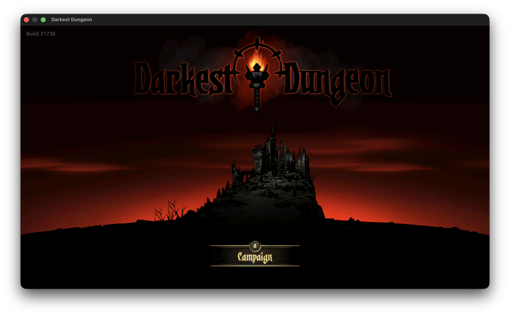

# Darkest Dungeon (`01008A700989A000`)

Base game 1.0.2 (`v0`), SDK 3.6.0. Red Hook Studios / Sickhead Games engine: renders with **desktop OpenGL 4.5 through EGL** on Metal (`dm/gfx/gl/hle_gl.m`). Modules `main`, `subsdk0` and `sdk`. Audio via 44100 Hz 2-channel output and VideoToolbox hardware H.264 (AVC) decoding.

On the Mac: the opening cinematics, main menu, Hamlet town, estate navigation, and dungeon expedition combat at a solid 60 fps with full audio and correct colors.

## What it needs

| Setting | Where | Why |
|---|---|---|
| [`gl_capture.tsv`](gl_capture.tsv) | profile | the 34 GLSL shaders assembled at run time from `shaders/*.glsl` in RomFS and `main`'s movie shaders; translated offline to Metal by `gl_shaders.py` |
| `modules main subsdk0 sdk` | [`game.tsv`](game.tsv) | `subsdk1` is NintendoSDK_OpenGL; the host's GL layer (`hle_gl.m`) answers OpenGL calls directly |
| `sys_resource 0x0`; `mem_reserve 0x40000000`, `mem_alias 0x10000000`, `mem_stack 0x10000000`, `app_pool 0xCD500000` | `game.tsv` | memory regions for SDK 3.6.0 |
| No NVN shader tables | `game.tsv` `shader_note` | OpenGL game without NVN shaders |

## Rendering (OpenGL)

- **GLSL 1.20 desktop shaders:** The game ships desktop `#version 120` shaders using `attribute`, `varying`, `gl_FragColor`, and implicit float conversions. `gl_shaders.py` upgrades them to `#version 450 core` for translation via `glslangValidator` and `spirv-cross` to Metal Shading Language. 3D texture samplers (`texture3D`) map to Metal 3D textures for color grading LUTs.
- **`glTexParameteriv` with `GL_TEXTURE_SWIZZLE_RGBA`:** The game sets 4-component RGBA swizzles (`0x8E46`) for 3D color lookup tables, handled in `hle_gl.m`.
- **Bi-planar NV12 video playback:** Video cutscenes use an NV12 bi-planar format (Y plane on unit 0 as `GL_R8`, UV plane on unit 1 as `GL_RG8`). The movie shader specifies `layout(binding = 0)` and `layout(binding = 1)`. `glLinkProgram` defaults sampler units to their layout binding points, ensuring `u_textureUV` samples from texture unit 1 with full chroma rather than unit 0.
