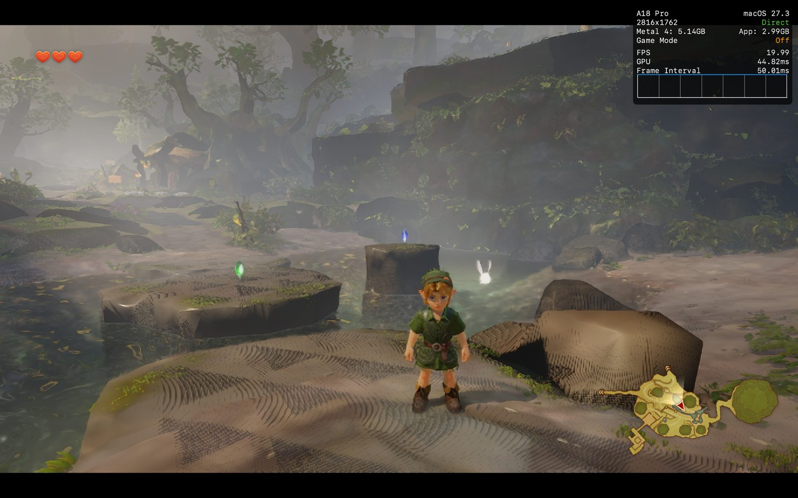
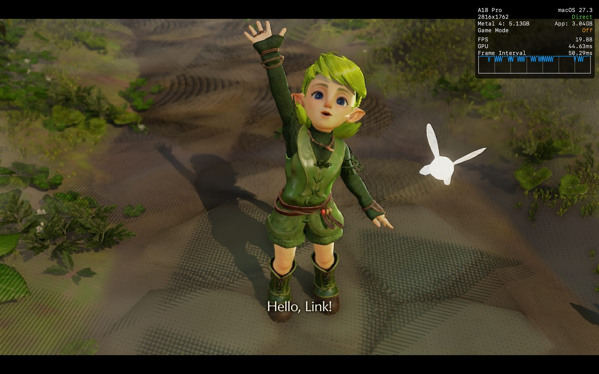
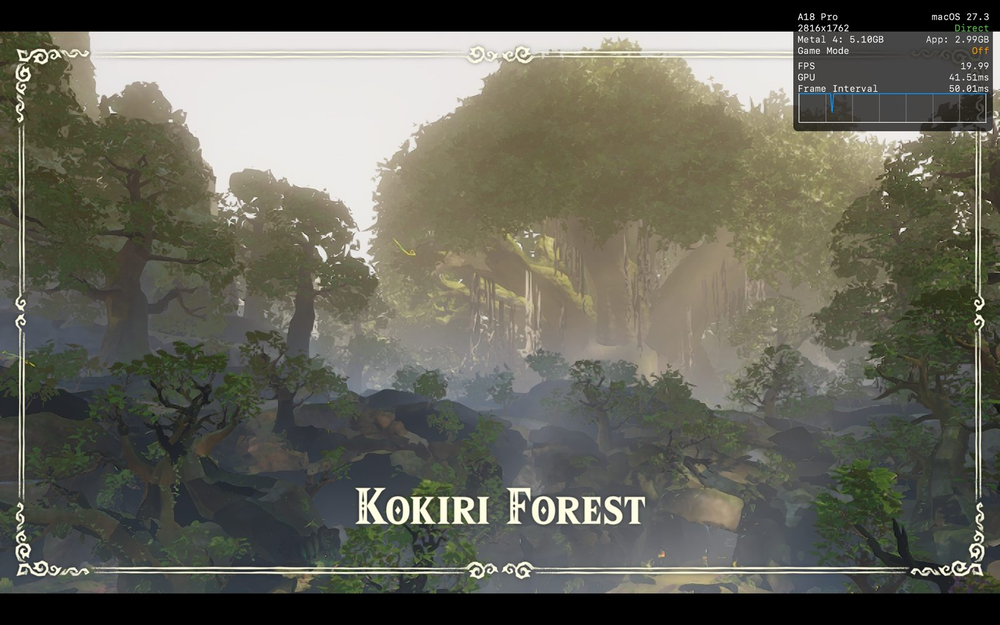
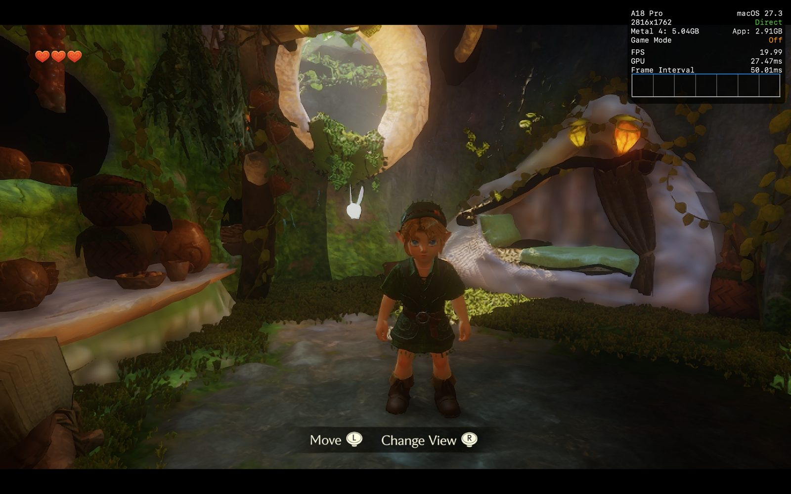
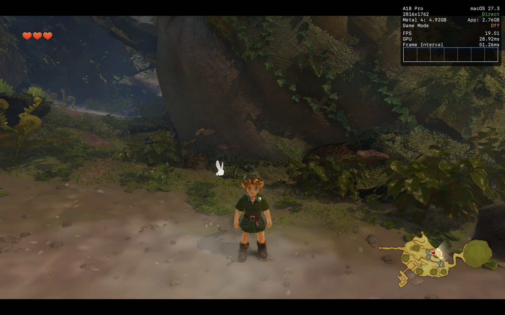
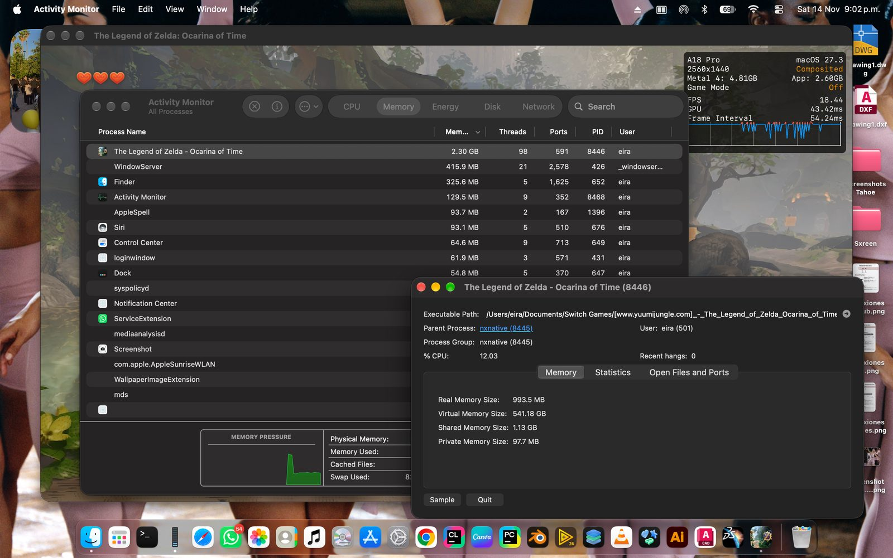
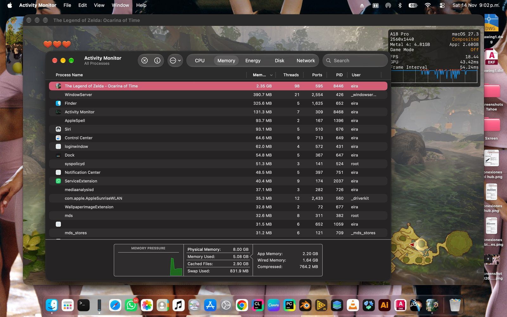

# Ocarina of Time low-memory kit for nxnative / NX2Apple

Makes **The Legend of Zelda: Ocarina of Time** (title ID `0400486024DEC000`, shader libraries `cb2e91c138e3`) run on a Mac with 8 GB of memory without `GPU out of memory` crashes, at a steady 20 fps, while keeping the UI and map sharp.

Tested on a MacBook Neo (A18 Pro, 8 GB, macOS 27.3), built with NX2Apple (host `dmhost`, NVN to Metal). It is a set of host changes plus two small tools. You bring your own legally dumped game; nothing here contains game data.

> **Status:** the Mac results below were measured by the project owner from the game's log and the Metal HUD. The iPhone builder has **not been tested on a device**. Treat it as a starting point and read its log.

## What it does

| Change | Switch | Effect |
|---|---|---|
| RAM saver | `DM_GUEST_FILE=1` | the game's own memory pools live in sparse disk files, out of the process footprint. App memory dropped from about 9 GB to about 2.6-3.0 GB, and the run got much smoother |
| Texture stand-ins | `DM_STAND_KB`, `DM_STAND_KB_MID`, `DM_STAND_KB_SMALL` | block-compressed textures are replaced by small stand-ins built from coarse mips, in three size tiers (big 512 KB and up, medium 128 KB and up, small) |
| UI / map bypass | `DM_TEXTURES_KEEP=ui` | textures that look like UI art (one mip level, non-power-of-two side) keep full detail: HUD, map, text. **Always on in both tools** |
| Texture drop | `DM_TEXTURES_OFF=big` | the biggest textures are not loaded at full size |
| Shadow map | `DM_SHADOW_DIV=1..48` | divides the 12288x12288 shadow map (and its scissor and viewport). 16 looked good, 48 is the lowest tried |
| Texture sweep | `DM_ALIAS_SWEEP=600` | every 300 frames, cached textures that nothing refers to and nobody used in 600 submissions are released. Gives back the memory a cutscene leaves behind (about 15 s after it ends) |
| 20 fps | `DM_FPS_TARGET=20` | holds 3 vsyncs per frame. The game steps in whole 1/60 s ticks, so 24 fps is not possible without slowing the game down |
| Optional | `DM_SKIP_WATER`, `DM_SKIP_EFFECTS`, `DM_SKIP_GRASS` | skip those shader families. Grass skipping also removes leaves and saves little: not recommended |
| Staging | `DM_UP_BLOCK_MB=8` | smaller upload blocks, about 140 MB less GPU memory, loads slower |

## Tested settings

These ran a full session including the opening cutscene without a crash:

```
DM_GUEST_FILE=1
DM_FPS_TARGET=20
DM_STAND_KB=6          # big textures
DM_STAND_KB_MID=4      # medium textures
DM_STAND_KB_SMALL=2    # small textures
DM_TEXTURES_OFF=big
DM_TEXTURES_KEEP=ui
DM_SHADOW_DIV=48
DM_ALIAS_SWEEP=600
DM_SKIP_WATER=1
DM_SKIP_EFFECTS=1
DM_UP_BLOCK_MB=8
```

Measured with that set (Kokiri Forest, 2816x1762 window): **19.5-20 fps**, **App 2.6-3.0 GB** in the Metal HUD (Activity Monitor: 2.3 GB), Metal working set about 4.8-5.15 GB against the recommended 5.46 GB. Before the RAM saver the process used about 9 GB.

A balanced starting point if the picture is too blocky: big 8, medium 4, small 2, shadow divider 16. Raising the texture numbers worked too (the owner went above the set shown); raise them one step at a time and watch the log's `GPU allocated`. If the log shows `GPU out of memory`, step back.

Detail levels: higher number = bigger stand-in = more memory. 1 is tiny and blocky, 32 is close to normal. Pick the level, not the byte count.

## Results

Screenshots from the tested set above (Metal HUD on: top right shows window size, Metal working set, App memory, fps, GPU and frame time).

| | |
|---|---|
|  |  |
| Kokiri Forest: App 2.99 GB, Metal 5.14 GB, 19.99 fps | Navi dialogue: App 2.75 GB, Metal 4.89 GB, 19.99 fps |
|  |  |
| Saria cutscene: App 3.04 GB, Metal 5.13 GB, 19.88 fps | Area title card: App 2.99 GB, Metal 5.10 GB, 19.99 fps |
|  |  |
| House interior: App 2.91 GB, Metal 5.04 GB, 19.99 fps | Forest with the map: UI and map stay sharp (the `ui` bypass), App 2.76 GB, 19.51 fps |
|  |  |
| The game process: real memory 993 MB, shared 1.13 GB, private 98 MB | Memory tab: game 2.35 GB of a machine with 8 GB, App Memory 2.20 GB |

The textures are visibly coarser on rock and ground (the stand-ins); characters, UI text, the map and the hearts keep full detail. The memory climbs about 0.3 GB during a cutscene and returns to the earlier level in about 15 seconds with the texture sweep on.

## Mac: patch an existing app

1. Keep `nx_ocarina_patcher.py`, `ocarina-host-156de5a1.patch` and `ocarina-fps20-156de5a1.patch` in one folder. Needs macOS, Python 3 with Tk, and (to build the host) Xcode with the Metal toolchain and git.
2. `python3 nx_ocarina_patcher.py` opens the window. Pick the game `.app`.
3. Left: resolution and frame rate. Right: the game app and the host. Bottom left: the memory options. Bottom right: buttons and the log.
4. Tick **RAM saver**, **Texture sweep**, choose the texture tiers, the shadow divider and 20 fps. The "also keep sharp" box is optional: **`ui` is always on, you do not need to type it.** Add sizes such as `256x256` only if some other art looks blocky.
5. Press **Get the checkout** (a folder with no spaces in its path), then tick **Build and install the patched host** and **Apply**. The app is signed ad-hoc again.
6. Turn the Metal HUD on (`DM_METAL_HUD=1`) the first time to see App memory and fps.

**Restore originals** puts the `.orig` copies back. Command-line version: `python3 nx_ocarina_patcher.py --help`.

If the app's own settings window had saved choices, press **Reset** there so the new defaults apply.

## iPhone / iPad: build, sign and install over USB-C

`nx_ocarina_ios_builder.py` wraps nxnative's own `scripts/build_ipa_from_nsp.py`: it patches the checkout, prepares the Xcode project, builds it signed with your Apple team (the project asks for the Increased Memory Limit entitlement), installs over USB with `devicectl`, writes `Documents/env.txt` and pushes the game files.

You need: a Mac with Xcode (iOS platform installed), Python 3.12+, the nxnative or NX2Apple checkout, your game's NSP folder and `prod.keys`, your Apple team ID (a free Personal Team has one), and an iPhone with A17 Pro or later on iOS 26+, connected by cable, unlocked, trusted, Developer Mode on. For fast game-file copies: `brew install libimobiledevice`.

`python3 nx_ocarina_ios_builder.py` opens the window; fill in the checkout, NSP folder, keys, team ID, pick the phone and press **Build, sign and install**. The first build takes 30-60 minutes. The tool saves your entries.

Caveats: untested on a device; the Mac patcher's resolution edit is not part of it; whether a free account keeps Increased Memory Limit depends on Apple's side, and the log will tell you.

## Reading the log

`[nvn-mtl] memory up to frame N: resident ..., GPU allocated ...` every few hundred frames. `idle shared texture sweep at frame N: X released, about Y MB` shows the sweep working. `[mem] guest file: ...` shows the RAM saver. Send these lines with a bug report.

## Known issues

- The log line for the UI keep prints a literal `%u KB` (cosmetic).
- `DM_TRIM_MEM` returned 0 MB in tests: leave it off.
- Cannot force low-LOD models: that choice is in the game's code, not the host.
- The shared buffers (about 2.2 GB) and the render-target heaps (about 1 GB) cannot be shrunk from the host, so GPU memory has a floor of about 5 GB.
- Written for the 10 nxnative commits from `80fc2ecb` to `156de5a1` (shader libraries `cb2e91c138e3`). The 20 fps patch does not apply to `80fc2ecb`.

## Layout

```
ocarina-lowmem/
  nx_ocarina_patcher.py          Mac app patcher (GUI + CLI)
  nx_ocarina_ios_builder.py      iPhone builder (GUI + CLI)
  ocarina-host-156de5a1.patch    host changes (dm/gfx/nvn/nvn_mtl.m)
  ocarina-fps20-156de5a1.patch   20 fps target (hle_nvn.c, loader.c)
```

The same changes are already committed on branch `ocarina-low-memory-156de5a1`; the tools detect that and skip applying the patches.
